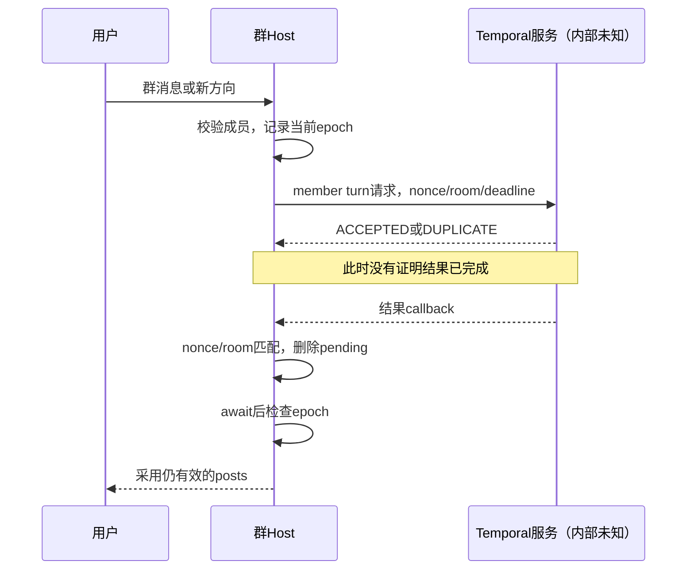

# Personal Agent · 完整 Claude Handoff（单文件版）

2026-11-04。包含主交接、证据梳理、更新设计、实施验收、决策记录、用户原报告全文和启动提示。

**本轮没有运行 REA、本机原函数实验或我们的 Agent 产品；文中本机测试结果均依原报告转述。** 原始 bundle、REA Evidence 和 12 份专题仍在用户本机，未随本包提供。

本文件可独立恢复文字上下文。全文中的相对文件链接在完整 ZIP 内有效；单独转交本文件时，其他文档内容已包含在后续相应部分，原始证据缺口仍不因此补齐。机器可读案例规格在完整包中，本文已包含其主要组别与实施标准。

推荐 Claude 先读第一部分和附录 A，再完整阅读设计与验收，按附录 B 接手。


---

# 第一部分：接手主文档

# Personal Agent：Claude 接手主文档

版本：2026-11-04 接手版  
状态：需求与设计已收敛；用户本机 REA 研究已推进到第五轮；本交接没有实现或运行我们的 Agent 框架。  
阅读入口：本文可独立恢复主要上下文。详细方案见 [更新设计](02_UPDATED_DESIGN.md)，取证范围见 [研究与证据](01_RESEARCH_AND_EVIDENCE.md)，实施与验收见 [实施计划](03_IMPLEMENTATION_AND_EVAL.md)。

## 1. 这到底是一个什么项目

用户包包需要自己的开源项目，既支撑 Agent 岗位面试，也帮助自己真正理解、实现和调试 Agent。用户有 C++/C# 工程背景，已经有 RAG、Goal/Gate/Trace/Stop-Loss 的实践和设计经验，但不能把此前的设计描述当成本项目已经有代码。

要做的是一个**业务无关、可自由创建多个 Bot、支持团队协作和持续目标的极简 Personal Agent 框架**。

用户交代目标和边界后，系统应当主动调查实现路径，发现必要工作，选择行动，组织协作，实际执行和验证，处理障碍，并持续调整后续安排。核心用户价值是：**少催办、少补漏、少指路、少手工接管，同时拿到可信结果。**

不是网站运维工具，不是自媒体专用流水线，不是只能经过总管的组织树，也不是用固定角色轮流发言的群聊演示。

研究网站、自媒体运营、资料维护等都是用于检验通用能力的例子。用户没有确定最终业务 Demo，不要把早前助手推荐的“技术笔记站”升级成用户已拍板的产品方向。

## 2. 必须保留的用户要求

| 编号 | 用户已明确的要求 | 实现含义 |
|---|---|---|
| U01 | 接住目标，而不是只回答或列计划 | Task、Goal 和一次模型运行分开；必须执行、验收、交付 |
| U02 | 主动发现工作，不要求用户给完整 SOP | 持续调查现状和差距，形成有证据的下一步，按需要注册触发与复盘 |
| U03 | 遇阻后充分搜索和尝试，不浅尝辄止 | 知道官方文档、GitHub、HF、X、社区等途径；实际查询、读取、实验留记录 |
| U04 | 不要被一句“你去某处查了吗”轻易问倒 | 对相关高价值途径有真实覆盖记录；访问失败、未查、无结果不能混淆 |
| U05 | 需要多 Agent，而且容易派生、组织、合作 | 共用内核；角色模板与实例分开；消息、委派、交接、产物和总体验收可追踪 |
| U06 | 用户可以自由建 Bot、私聊、拉群、直接指导任何成员 | 总管可选；目标有负责人不等于全工作台只有一个入口；Room 不等于 Team |
| U07 | 日常交流口语化，不要每次长篇汇报 | 内部结构化；外部简短自然；重要阻塞和成果不能静默；报告按需展开 |
| U08 | 结束前可注入 Nudge，提醒遗漏的探索途径 | Runtime 判断是否需要继续；正常等待、完成、取消、预算暂停不强拉模型 |
| U09 | 极简、可插件化，借鉴 Pi 的思路 | 小而清楚的状态与动作协议；领域知识、角色、渠道、模型、工具可替换 |
| U10 | 目标导向，实际测试，完成后说明状态 | 代码和运行结果比方案口号重要；未测、模拟、原函数隔离和真实任务明确分开 |

“穷尽办法”应落实为：在授权、预算和时间边界内，不跳过明显有价值的调查、实验或替代路径。预算耗尽叫暂停；缺凭据叫外部条件阻塞；当前未找到解法不等于证明无解。不要以无限执行、绕过授权或刷工具调用来装作坚持。

## 3. 当前研究状态：这次已经前进到哪里

### 3.1 来源及可信范围

最新依据是用户提供的 [五轮综合报告](sources/最简PersonalAgent完整调研与设计取舍.md)，下文简称 R1。R1 原件完整保留，未改写。其报告日期为 2026-11-04。

**本交接已完整读取 R1、原 Codex 任务及附带的早期分析包。没有取得或重跑用户本机的原始 Host、EVAL、REA Evidence 与五轮测试脚本。** 因此“原函数测试通过”是本机报告的陈述，不是本轮独立复现。

R1 报告：REA 已实际运行，固定 6.8.0，隔离 Node 26.13.0。不要重新把“REA 安装失败”当作本机当前状态。早期失败发生在另一个 ChatGPT 容器里，保存在 legacy 中，仅供追溯。

| 样本 | R1 报告已取得 | 结论边界 |
|---|---|---|
| G078 | 官方 Linux 桌面 0.78.1、ASAR/JS；Windows 0.78.1.0 只读观察 | 客户端、界面与桥接，不等于云端执行器 |
| HOST | 官方公开更新 2b353c7 的 tgz、同源 SHA、完整 Host bundle | 当前取得产物的可见代码，不证明账号部署版本或服务端实现 |
| H018 | 固定 commit 的第三方历史归档及切片 | 历史样本内部行为；官方来源和当前启用不能据此推断 |
| EVAL | 与 HOST 同包的 sand-eval-runner.cjs | 更完整提示装配、恢复与专用保护；评测实现不是已确认线上配置 |
| Muse | 官方网页分发 JS | 网页可见边界，受资格限制的客户端及后台仍未知 |

HOST 主文件报告 SHA-256：
`328b715bed51ac13f549319f84af259b80936cd984e161af4c45a0faad0f1c35`

### 3.2 本地新增发现，必须反映到方案

**A. 身份与责任。** 长期 Bot 和临时 Worker 可以共用执行内核，但不能共用生命周期假设。用户直达任意 Bot；会话是交流场所，不承担任务唯一身份。根负责人不会因为 Worker 返回结果就自动免责。依据：R1 第一节。

**B. 接受不等于完成。** 当前群 Host 可见 Temporal 适配链：校验与分发 → 发送 member turn 请求 → 后台未知 → 回调 → nonce/room/pending 匹配 → epoch 检查 → 采用 posts。请求接受、执行、结果回传、投递、验收是不同事实。依据：R1 第二节。

**C. 停止、失败保护和有效进展必须分开。** 当前共享 GoalContinuationActionHandler 的某些分支会被“仅请求工具”或失败工具结果清零空转计数；连续无工具前三次续跑、第四次进入暂停。另一个严格结束函数检查工具成功；EVAL 还有电脑操作 Worker 专用的连续失败 breaker。这些机制同时存在，不能概括成“Grok 没有失败保护”，也不能把调用工具当成业务进展。依据：R1 第三节、第十一节。

**D. 提示装配的证据比上次更完整。** 同包 EVAL 发现 buildAgentForRun、createSystemPromptAssembly、generator、renderSections/renderSystemPrompt 与消息角色。记忆政策在 system，部分事实在 gate 下进 UserInfo user；具体顺序、override、frozenPrompt、subagent 条件都有边界。不能继续说“当前只能找到接口”，也不能说“线上最终提示已完整取得”。依据：R1 第五节、第十一节。

**E. 压缩恢复要有版本边界。** EVAL 在同 epoch 固定旧前缀，用 instructions_update 宣告变化；下一 epoch 读取 live。依赖未解析保留旧值，明确删除才清空。已有 helper 隔离验证，但没有完整真实压缩回合。我们应独立实现“持久事实不丢、快照可追踪、更新可生效”，不机械照搬其协议。依据：R1 第十一节。

**F. 记忆字段不是权限保证。** owner、audience、source、speaker、类型和用途有参考价值；helper 传递 audience 不证明它执行 ACL。部分未信任目录被跳过，也不证明整条输入链安全。八种注册类型、四种默认旧类型，以及 dreamPrompt 的存在，都不等于新记忆/自动复盘在线上默认启用。依据：R1 第四节。

**G. 调度不是自主规划。** routine/todo/goal/dream 文本各自证明范围有限。本轮还发现 routine run 中不能新建 routine，更新只允许相应唤醒来源修改自身，且有 review/重新启用限制。我们应把“发现并建议策略”与“有权激活策略”分开，不让每个定时 Worker 无限扩展长期工作。依据：R1 第六节、第十一节。

**H. 清理 RPC 成功不等于实际收敛。** CloudSync 在已读样本里承担的是删除 Bot 后的远端 routine 清理，而不是通用云端同步。回读确认比一次 RPC 返回重要。不能把进程内 pending Set/Map 认作持久恢复机制，更不能据此断言服务端没有恢复。依据：R1 第二节、第十一节。

### 3.3 测试数字怎么说

R1 分范围列出：前两轮 105；第三轮当前 HOST 40；第四轮当前 HOST 25；第五轮 HOST 22、EVAL 18，共新增 40，报告这 40 项全部通过。真实远端模型实验为 0。

不要合并成“当前云端 210 项验证通过”，不保证跨轮用例独立，不把早期六项测试或对话里提过的七项机制实验重复加入。详细缺件和复现入口见 [研究与证据](01_RESEARCH_AND_EVIDENCE.md)。

## 4. 更新后的框架方案

本节及 [详细设计](02_UPDATED_DESIGN.md) 是我们的设计决定，不是还原 Grok 内部实现。

### 4.1 一套内核，多个身份，按目标组织

长期 Bot、临时 Worker 使用同一 Agent loop。用户可以直接创建、命名、修改和联系 Bot；Team 只是成员、共享范围及协作约定，负责人按目标指定，不是强制永久总管。

最低概念是 Bot/Worker、Room、Goal、Policy、Task、Run、Evidence/Artifact/Delivery。概念清楚不等于必须每个概念一张表或一个服务。源码先集中在一个 Python 项目中，用 SQLite 和本地文件目录；不因为看到 Temporal 就先引入分布式工作流平台。

### 4.2 一个明确的目标闭环

用户目标与边界 → 观察现状 → 找出差距 → 选择能验证的动作 → 执行 → 核对结果 → 继续、重规划或等待。

发现工作贯穿始终，不能只在首次生成计划。少量领域模板用于检查遗漏，不能替用户调查真实环境，也不能把自媒体/网站 SOP 写死成核心逻辑。

### 4.3 消息、任务、完成和交付分开

普通聊天可以只产生回复；需要做事才建立任务。发消息不自动授权、不转移任务归属、不代表结果被接收。委派要有父任务、具体输入、要求版本、验收、预算及结果路由。handoff 是明确的责任变更，不是自然语言的“交给你了”。

执行结果、验收和投递分别保存。任务可已验收，但消息待发送；只重投结果，不重做业务。晚到或旧版本结果保留为候选证据，不能直接覆盖新要求。取消请求已发出不代表外部动作已停止。

### 4.4 Nudge 是有证据的结束前检查

不能仅由“无工具调用”触发，也不能以“又调用工具了”自动判进展。结束检查先看待执行工具、当前要求、取消/预算、有效等待、验收和交付，再判断探索或职责是否有明显缺口。

活动计数、工具失败熔断、有效进展、总预算分开记录。Nudge 注入目标、已试路径、缺证据和未查相关来源，而不是一遍遍喊继续。任务、目标和整个团队都受持久预算约束；换 Worker、压缩和重启不能重置额度。

### 4.5 上下文和记忆分层

当前任务账本是运行事实；长期记忆是带来源、范围和版本的可修订信息；摘要是可重建的上下文材料。压缩不得删除原始验收、未完成项、授权引用、调查覆盖和委派状态。

每轮保存上下文来源/版本，不保存或要求披露完整内部思维链。用户原始授权、同伴转述、网页资料分别标识；同伴说“用户同意”不能新增权限。私聊材料不会因为群成员可见就自动进入共享记忆。

### 4.6 长期工作与策略变更分开

周期或事件触发绑定 Goal/Team/稳定角色，而非某个临时 Worker 的对话。运行时保留 schedule receipt、时区、漏触发策略和最近观察结果；“写了 todo”不等于已安排。

日常 Worker 可以发现缺项并提交策略修改建议。目标负责人或既有授权的策略接口负责验证、去重、预算检查和激活。无需每次内部调整都问用户，但 Worker 不能自行扩大目标、发布权限或成本。

### 4.7 对话方式

日常简短自然，例如“查到一个相关 issue，我先按你的版本试一下。”完成时交付链接或文件，并说明验过什么。需要决定时只问缺的决定。内部可以严谨，前台不强迫用户阅读 schema、运行 ID 或全员聊天记录。

## 5. 开发范围与先后顺序

多 Bot 和协作从数据模型、权限及消息协议第一天就要兼容；实现按可验证切片推进，不等单 Agent 做完再推翻模型，也不先造大组织平台。

| 阶段 | 交付 | 核心验收 |
|---|---|---|
| M0 | 一个 Bot、真实模型与工具、任务与交付账本 | 自然语言任务实际完成、失败不报成功、结果可查 |
| M1 | 等待、要求修改、取消、结束检查与有界 Nudge | 等待不空转；旧结果无权覆盖新要求；失败和成功无新增内容都不能无限续跑 |
| M2 | 临时 Worker 和可靠交接 | 委派可查、结果回传、返工后接续、原负责人持续验收 |
| M3 | 自由创建多个 Bot、直接私聊与群协作 | 不强制总管；消息路由/私有记忆/成员退出有明确行为 |
| M4 | 可靠周期与事件触发、持续目标 | 重启后职责仍在；无变化合法等待；停用后不因晚到触发复活 |
| M5 | 策略复盘、对照评估与真实自用 | 新策略关联证据与假设；结果质量和用户管理成本可测 |

真实模型不是最后才接。没有模型凭据时，先跑确定性协议测试并保留真实测试命令，明确 real_model_e2e=not_run；不能用替身结果宣称 Agent 可用了。

第一条验证任务可以是“维护一组资料的准确性”：给定若干来源和现有文本，发现变更、遇到矛盾后调查、修订并验收。再用用户的自媒体例子验证可替换配置和持续工作，而不是为第一场景写死一个业务框架。

## 6. Claude 接手后的第一轮工作

1. 完整阅读本文、R1 和 [详细设计](02_UPDATED_DESIGN.md)，然后阅读 [实施与验收](03_IMPLEMENTATION_AND_EVAL.md)。把已有结论与未知分开，不让上下文压缩重新引入旧设计。
2. 只读盘点本地工作区、git 状态、REA/Node 安装位置及已有代码。不要默认本项目已空白，也不要把研究目录当产品目录。
3. 在可见本机目录中定位原始报告与证据；先检查最新第五轮专题和对应日志/脚本，再决定是否复跑关键测试。已有 REA 可用就沿用固定环境，不默认升级或全局重装。
4. 若原始证据不在 Claude 所处环境中，记录缺失路径；它影响复核 Grok 结论，但不阻止独立实现我们的协议。不要自动访问用户账号、唤醒 Grok 云电脑、开通额度或触发收费调用。
5. 输出一份短 STATUS：确认哪些材料可见、有哪些代码、当前切片是什么。随后开始 M0；已有 M0 时按真实测试选择下一个未通过切片，不重复搭脚手架。
6. 每个切片必须有代码、测试、实际结果和状态文件。达到验收后再扩下一个能力，不以继续研究所有后端未知项作为长期阻挡。

这个接手默认推进实现。历史 `codex_rea_grok_bot_task.md` 的“本轮只研究、不实现”只约束原研究任务；它不是新接手阶段的永久禁令。

## 7. 原始本地研究怎么找

R1 提供的路径如下，属于**待在用户本机确认的定位线索**，不是本交接环境已经存在的目录：

```text
C:\Users\asus\Documents\Codex\2026-11-03\github-rea-grok-bot-muse-personal
└─ work/research/grok-bot-rea/
   ├─ targets/host-2b353c7/sand-host/host-main.cjs
   ├─ targets/host-2b353c7-phase4/
   ├─ evidence/phase4/
   └─ scripts/verify-phase4.py
```

R1 给出了第四轮复现命令，但没有给出第五轮脚本命令。接手时从第五轮专题、commands 或 scripts 中找真实入口，不能臆造 `verify-phase5.py`。

## 8. 不要倒退到这些方案

- 不要再把项目限定为网站运维或自媒体流水线。
- 不要强制所有话经过一个主 Agent；不要把群聊天然当组织上下级。
- 不要把工具调用数、工具成功数、文本输出量当成有效进展。
- 不要写“穷尽全网已经无解”，除非确有足以支持该限定结论的证据。
- 不要用摘要代替用户要求完整阅读的资料，或把模型的自报检查作为真实覆盖。
- 不要用提示词代替权限、状态版本、外部动作去重和取消检查。
- 不要把 EVAL、旧归档和服务端未知部分拼成一套当前生产架构。
- 不要从私有逆向目录复制专有实现/完整提示词到开源仓库；我们的代码和提示词独立编写。
- 不要把“文档整理校验”或者“mock 测试通过”写成真实产品验证。

## 9. 本次交接的完成范围

已完成：新报告与既有需求整合，研究边界校正，更新设计、实施顺序和验收规格；历史材料与新报告分别保存，缺失原始证据单独列出。

未完成：我们的框架代码与真实端到端评估；本机 REA 实验的独立复跑；线上 Grok 服务端与最终提示请求确认。不得因交接文件完整就把这些项目标为完成。


---

# 第二部分：研究与证据

# 01 · 调研、逆向与证据交接

日期：2026-11-04。本文区分“本轮读到的材料”“材料报告的实验”和“我们的设计”，不声称重新执行用户本机研究。

## 1. 来源分层

| ID | 来源 | 本轮读取范围 | 适合支持什么 |
|---|---|---|---|
| R1 | [用户上传的第五轮综合报告](sources/最简PersonalAgent完整调研与设计取舍.md) | 全文，结论、版本范围及第一至十一节 | 本机研究进展、报告陈述的观察/隔离实验、局限和建议 |
| R2 | [原 Codex 研究任务](sources/codex_rea_grok_bot_task.md) | 全文 | 原研究意图、授权边界、调查优先级；不是执行结果 |
| R3 | [早期分析包](legacy/grok_bot_rea_analysis_20261103.zip) | 12 个成员文件全文，包括六项测试脚本/结果、索引与四份原创候选提示 | 历史代码分析范围；早期设计演变；不证明当前实现 |
| R4 | [早期安装尝试](legacy/rea_install_attempt_20261103.zip) | 全部成员文件，包括命令、错误和未实跑离线脚本 | 旧容器安装失败的历史事实；不是当前本机环境 |
| C1 | 本次聊天中用户的逐轮要求 | 当前上下文中的完整需求和纠偏 | 产品约束；已整理到主文档 U01–U10 |

源文件字节哈希和本轮读取状态在 [sources/MANIFEST.json](sources/MANIFEST.json)。用户原报告不做修订；更新后的设计另写，避免来源与推论混杂。

R1 的全文已经在本轮阅读。它链接的专题、样本、脚本没有随附件提供；“报告描述原函数已测”不能改写成“本轮亲自检查了该原函数”。

### 冲突时怎样处理

用户明确要求决定产品目标；R1 第十一节用于细化同一报告早前的未知结论。新样本和旧样本分别成立，不能用新样本修改历史记录。我们独立的设计可与参考产品不同，但要标为设计决定。

历史任务 R2 的“只研究”范围已经结束，不阻止本次交接进入实现。旧容器的 REA=false 和新本机的 REA 已运行也不冲突：环境和执行时间不同。

## 2. 已做调研如何沿用

此前对话调研过 Pi、OpenClaw、Grok Bot、Hermes、nanobot、NanoClaw、Letta，也讨论过持久工作流、消息 inbox/outbox、MCP 与渠道接入。这轮的任务是整合用户报告，不是重新核实这些项目的最新版本。

| 历史参考 | 已影响我们设计的方向 | 本轮保留方式 |
|---|---|---|
| Pi | 小内核、模型/循环/扩展分层、配置化角色 | 作为架构思路，不依赖未经本轮核实的具体 hook 名称 |
| OpenClaw | 接入、会话、目标续跑、团队路由与调度分层 | 参考职责分离，不把它与 Grok 样本拼成同一产品 |
| Hermes | 程序性经验、定向消息、执行/投递分别跟踪 | 作为已有方案动机；新代码需核实实际依赖 API |
| nanobot | 把一次模型工具循环与会话/长期目标分开 | 反映在 Task/Run/Goal 边界 |
| NanoClaw | 核心可理解、明确隔离、扩展不全部内置 | 不把逻辑工作目录当安全沙箱 |
| Letta | 长期身份、记忆和 conversation 分开 | 反映在 Bot、Room 和记忆范围 |
| 持久工作流与 outbox | 状态、外部副作用、重试和投递的边界 | 独立实现最小协议；不先上 Temporal/Kafka 等平台 |

早前对话出现过 Pi `agent_before_settle` 等 API 名称，也出现过“当前默认功能”的判断。本次附件没有为这些 API 提供新证据；Claude 真要集成时再查对应固定版本，不把聊天里提过等同于已验证依赖。

以下仅是历史参考入口，本轮没有重新访问或核验：

- Pi：`https://github.com/earendil-works/pi`
- OpenClaw：`https://docs.openclaw.ai/`
- Hermes：`https://github.com/NousResearch/hermes-agent`
- nanobot：`https://github.com/HKUDS/nanobot`
- NanoClaw：`https://github.com/nanocoai/nanoclaw`
- Letta：`https://docs.letta.com/`
- REA：`https://github.com/morluto/rea`

这些入口不是本轮发现的佐证；本轮产品机制事实以 R1 的证据级别和边界为准。

## 3. 样本、工具和版本

据 R1“证据与版本范围”及第十一节：

| ID | 样本/工具 | 已报告取得的内容 | 不能跨越的边界 |
|---|---|---|---|
| REA | 6.8.0 | 本机固定版本实际分析；第四轮另分析 12 个原字节模块，第五轮分析同包 EVAL 原模块 | 本交接未拿到 CLI/MCP 原输出，不代称本轮实跑 |
| Node | 隔离 26.13.0 | 本机运行环境 | 不改写为本交接容器的 Node 版本 |
| G078 | 官方桌面 0.78.1 | Linux 包、ASAR/JS；Windows 0.78.1.0 只读观察 | 桌面版本不等于 Host/模型服务版本 |
| HOST | 官方公开更新 2b353c7 | 公开 tgz、同源 SHA、Host bundle | 发布产物不证明账号云电脑实际部署版本 |
| H018 | 历史第三方归档 | 固定 commit 的 bundle 与切片 | 不证明官方来源或当前仍启用 |
| EVAL | HOST 同包 sand-eval-runner.cjs | 更完整评测运行器与提示装配链 | 不是已确认的生产服务端，未运行整个评测程序 |
| Muse | 官方网页 | 网页实际 REA 分析 | 受资格限制的其他产物和后台未取得 |

R1 记录的 HOST 主文件 SHA-256：

```text
328b715bed51ac13f549319f84af259b80936cd984e161af4c45a0faad0f1c35
```

下列 HOST LF 锚点仅对这个主文件有效。EVAL 的精确行号和字节证据在未附带的第五轮专题中，不能照抄 HOST 行号给 EVAL。

## 4. 发现登记：结论、范围、设计影响

### F01 · 长期 Bot、Worker、Room 不应合并

**报告内容：** H018 长期 peer 与 parent/worker 路径不同；当前 Host 另外观察到 peer 记录和群 Temporal 调度。Bot 可长期存在，Worker 关联有限委派；会话不应作为任务唯一身份。  
**证据级别：** R1 第一节描述的历史/当前静态与既有隔离材料，具体当前服务端创建销毁未知。  
**设计影响：** 稳定 Bot + 临时执行身份，共用 loop；用户直达；任务可跨多次 run。

### F02 · 当前群回传链有匹配和过时保护

**可见链：** 本地群入口 → 成员校验/分发 → runTemporalGroupMemberTurn → requestGrokBotRoomMemberTurn → 服务端未知 → receiveRoomMemberTurnResult → nonce/room 匹配 → 删除 pending/resolve → epoch 检查 → posts。

**HOST 锚点：** LF722149 起 Temporal 适配器；LF758648 起分发；LF760252 起 epoch。R1 第二节引用第三轮相关 15 项。  
**边界：** ACCEPTED/DUPLICATE 不是完成；peer 本地记账和内存去重不是接收方执行证据；服务端事务与恢复不可见。  
**设计影响：** 可查询委派；要求版本进入子任务与产物；晚到结果隔离保留；投递与验收分开。

### F03 · Goal idle 清零不等于有效进展

**原函数锚点：** GoalContinuationActionHandler LF595585–595760；ToolCountingStateTracker/createToolCountingMiddleware LF585170–585234；身份/时钟 LF490199 起。

R1 第三节报告原函数隔离结果：

- 无工具前三次续跑，第四次尝试前暂停，累计续跑仍为 3。
- model-step 只看 descriptors，工具未执行即可清零；连续 20 次同类无效描述仍清零。
- single-step 看 hasToolCall，包含失败信息仍清零。
- 完整 handle 在 await record 后加一；已记录失败结果清零，record 抛错时不加一。
- 模型异常保留已增加计数；暂停、身份不符、非法 ID 不进入模型。
- 时钟倒退不倒扣；无 anchor 的等待不计入工作时长。

**边界：** 局部控制流，不含真实工具/网络/模型/生产 scheduler，不能推出线上无限运行。  
**设计影响：** 活动、失败、进展和预算必须独立。

### F04 · 严格结束函数与 goal idle 是两个层次

R1 第三节说明 resolveStepTurnEnd（LF587738 起）要求明确成功结果，能在并行工具失败时阻止结束。它不证明目标进展，与 F03 不矛盾。

**设计影响：** turn settling 先解决待执行/失败工具；task acceptance 再判任务；goal review 再判长期目标。不能一个布尔 done 覆盖全部。

### F05 · 电脑 Worker 还有专用失败 breaker

R1 第十一节报告 EVAL 的电脑操作 Worker 专用保护：连续 20 次失败触发，成功清零，审核拒绝/取消事件跳过，触发后锁定。

**边界：** 不是所有 Bot 通用能力，不是有效进展检查，也不是我们应复制的默认阈值。  
**设计影响：** 失败熔断独立建模；成功但重复无新信息也需停滞判断；外层预算仍兜底。

### F06 · 同包 EVAL 提供具体提示装配链

R1 第五、十一节：buildAgentForRun → createSystemPromptGeneratorForRun → renderSections/renderSystemPrompt → system；同包包含完整 createSystemPromptAssembly 与基础提示构造。

报告的默认章节顺序：base/spotlight/voice → profile/用户/团队 → multitask/时区 → memory/会话 → automations/tasks/skills/channels/成员目录/发送规则/MCP → 电脑环境。

缺功能可省略；override/frozenPrompt 改变结果；任务章节对 subagent/system override 不启用；工具 schema 单独构建，实际挂载工具也影响能力描述。记忆政策留 system，部分事实通过 gate 进入 UserInfo user。

**边界：** EVAL 的真实实现，不是生产最终请求。没有原始文件时不能给 Claude 伪造完整 prompt 或替它补动态变量。  
**设计影响：** 分层上下文构造、有来源/版本、有消息角色、有实际工具清单；测试不同 actor 与压缩状态下的输出。

### F07 · 压缩恢复具有 epoch 语义

R1 第十一节：同 epoch 冻结旧前缀，用 instructions_update 表达变化；下一 epoch 重读 live。依赖未解析保留旧值，明确删除才清空；切换对象重新准备 notes；压缩代次变化刷新 profile，异常清理临时代次。

**边界：** 原 helper 隔离验证，不是完整真实压缩回合。  
**设计影响：** 删除/未加载语义分开，上下文快照可追踪；即时取消/撤权必须由 runtime 执行，不能等下一次摘要。

### F08 · 记忆来源与受众必须另有强制边界

R1 第四节：user/bot owner 映射 /me、/bot；always_in_context/library；behavior、workstream；source/speaker/created_at；untrusted_raw/pending_review；team/user audience。

**HOST 锚点：** LF717318 schema；LF777025–777096 类型和默认集合；LF777102–777231 helpers；LF777254 起提示常量。

原 helper 测试报告：未信任前缀解析前跳过，旧 shard/未知类型不进该 view，按路径/时间/ID 排序；同 ID 此 helper 不去重；audience 只传递；路径前缀检查不能证明上游规范化。JSONL parser 用供应预验证记录的替身，没验证真实 Zod/后端隔离/抽取/遗忘。

**关键条件：** 8 种注册类型，但默认集合只有 4 种旧 profile/journal；dreamPrompt 没有在已读范围追到定时执行链。  
**设计影响：** 任务账本、长期记忆、摘要分开；事实有来源与范围；存储层检查访问，不依赖目录名称或 prompt。

### F09 · 同伴提醒有多个变体，启用仍未知

HOST LF774042–774085；R1 第五节。提醒包括不能代表用户批准、可沿原会话代问用户、后台结果写回 owner notes 等变体；本轮尚未追到生产选择/注入条件。

**设计影响：** 传递原始授权引用；同伴消息作为有身份的数据，而不是变成高优先级用户命令。不要选一段提示冒充当前产品统一行为。

### F10 · 调度配置、历史和远端收敛不同

R1 第十一节：服务接口有 workflow/run/过滤/重试资格；后台实现不可见。FileAutomationStore 分配置与运行历史；同 Bot 变更队列仅进程内串行。CloudSync 是 Bot 删除后的 routine 清理，流程列出→删除→回读；回读空也可消解一次 RPC 错误，本地 pending Set 未见跨实例恢复代码。

**设计影响：** 记录 desired/observed 及未决清理；只在确有远端适配器时添加对账；RPC 失败可能结果已生效，需要读回。不要凭模块名画通用云同步系统。

### F11 · Routine 执行权限有真实分支约束

R1 第十一节报告六项原分支：routine run 拒绝创建另一个 routine；更新必须确认唤醒来源、仅能改自身、不得重新启用；需要 review 而 Host 无法 review 时拒绝更新。

**设计影响：** 周期 Worker 负责当前任务和发现，目标负责人/策略接口负责持久策略变更。不是照搬全部限制，而是明确派生与计划扩展的权限边界。不能据分支测试宣称调度闭环已完整验证。

### F12 · 当前生产后端仍是未知边界

R1 结论与第九/十一节：普通 Box 模型入口已退役；当前生产执行器、数据库、队列、租约、事务、全局预算和真实开关未取得。已有 HOST/EVAL 可继续离线研究，但不能替代服务端证据。

**设计影响：** 小框架独立实现可靠语义，不以“完整复刻 Grok 云端”为前置目标；不要把旧 Host 直接当运行底座。

## 5. 测试账目，不合并口径

| 范围 | 报告数量 | 本交接材料 | 应怎样描述 |
|---|---:|---|---|
| 前两轮 | 105 | R1 统计与链接；专题未附 | 历史样本与桌面等研究用例，不是当前云端测试 |
| 第三轮 HOST | 40 | R1 统计/部分机制描述；专题未附 | 当前取得 HOST 原函数相关验证，部署状态未知 |
| 第四轮 HOST | 25 | R1 详细摘要与复现入口；脚本未附 | goal 及 memory helpers 的隔离测试 |
| 第五轮 HOST | 22 | R1 第十一节 | 与 EVAL 18 合计新增 40，报告全部通过 |
| 第五轮 EVAL | 18 | R1 第十一节 | 评测运行器相关隔离测试，未跑完整评测程序 |
| 真实远端模型 | 0 | R1 第十节 | 不能报告线上/自主任务成功率 |
| 早期 ChatGPT H018 probe | 6 | R3 提供脚本与结果，但不含被测第三方模块原件 | 历史隔离测试，不重复并入本机轮次 |
| 早期对话所称机制实验 | 7 | 当前包未包含该独立实验原件 | 仅历史对话陈述，不计入本交接可复核结果 |

本轮只进行文档/来源/包完整性检查，没有执行上述任意一组原函数测试。即便以后复跑，也要记录具体脚本、样本哈希、依赖替身、退出码，不能沿用上一轮的“通过”。

## 6. 缺失原件与恢复路径

综合报告内 12 个相对链接的专题未随本轮上传。清单在 sources/MANIFEST.json，包含当前官方 Host 深挖、第五轮专题、第四轮验证、协作、提示、长期任务和 Muse 等。

用户本机研究根（R1 第十节给出，待确认）：

```text
C:\Users\asus\Documents\Codex\2026-11-03\github-rea-grok-bot-muse-personal\work\research\grok-bot-rea
```

R1 已给第四轮原入口，读取脚本并核对目录后再执行：

```powershell
Set-Location 'C:\Users\asus\Documents\Codex\2026-11-03\github-rea-grok-bot-muse-personal'
python work/research/grok-bot-rea/scripts/verify-phase4.py
```

据报告该脚本验证主文件 SHA 和 12 个模块原字节，然后用隔离 Node 跑 25 用例，不启动 Grok、模型或私人聊天。本交接未审阅该脚本，接手者仍需先读取核查。第五轮命令在对应专题，未在汇总中提供，不猜测文件名。

本机先前额度已满、云电脑休眠。那是研究时点记录，不推断今天仍然如此，也不自动唤醒或增加付费额度。可继续离线，不依赖真实账号实验启动产品实现。

## 7. 继续研究的优先级

仅为解除实际实现中的不确定性而补证。优先核对本地第五轮记录与哈希；按需要继续 EVAL turn settle、Worker revival、state adapter 与 gates。对它们当前知道“值得追”，不知道“已证明如何运行”。

新服务端证据和真实账号实验需要独立范围与授权。我们的最小实现不必等待所有这些未知解锁。开源实现应基于行为要求独立重写，第三方原提示和 bundle 留私有目录。


---

# 第三部分：更新设计

# 02 · 更新后的最简 Personal Agent 设计

版本：2026-11-04。**本文件是我们的独立设计，不是 Grok 内部数据库/代码的还原，也不是已实现功能清单。** 研究依据与限制见 [证据文档](01_RESEARCH_AND_EVIDENCE.md)，决定来源见 [变更记录](04_DECISIONS_AND_CHANGES.md)。

## 1. 目标与非目标

用户表达一次目标后，系统在授权、预算和时间范围内持续负责：理解目标、调查实现路径、发现需要做的工作、组织资源、执行、验证、交付、观察效果，再选择下一步或等待。

关键不是“不断调用模型”，而是每个活跃目标都能回答：现在谁负责，当前缺什么，有什么值得做的动作，或者在等哪项事实，结果怎样验收。

**不做的事情：** 不写死自媒体或网站业务；不强制总管；不预设所有任务需要多 Agent；不把无限搜索当作毅力；不先做复杂 UI、插件市场、跨机器联邦、无限组织树或向量记忆平台。简单任务可以由一个 Bot 完成，但身份和协议必须支持多个 Bot。

## 2. 小内核与插件边界

候选技术路线沿用 Python + asyncio + SQLite + 本地文件。一个服务实例、有限并发，不为角色拆微服务；已有代码或运行时选择需先实际盘点。模型通信使用一个已核验的正式 SDK，先打通一种提供方。

| 部分 | 核心负责 | 可替换或扩展 |
|---|---|---|
| 接收/路由 | 来源身份、消息去重、Room 受众、绑定任务 | CLI/IM/Web UI 适配器 |
| 工作账本 | 目标、责任、版本、证据、等待与投递 | 导出/看板；首版不做通用存储插件框架 |
| Agent loop | 上下文装配、工具执行、结果回填、控制权交还 | 模型、角色提示、方法/skills |
| 团队协作 | 派生、分配、交接、消息关联、成果接收 | 角色/团队模板、分工建议 |
| 调度/恢复 | 持久唤醒、去重、未决工作扫描、暂停传播 | 定时/事件观察源、远端调度适配 |
| 检查/反馈 | 停止门禁、预算、取消、完成证据 | 领域验证器、调查/复盘策略 |

Source 目录和领域 Playbook 可以先是版本化配置/文件；不必各自建一个复杂 SDK。插件首版显式注册。角色说明和插件文本不授予实际权限；运行时/工具代理/存储执行授权。

## 3. 概念与身份

以下是候选逻辑契约。它们不要求逐项建立表；先保证关系和不变量，再决定最少 SQL 结构。

| 概念 | 保存什么 | 关键约束 |
|---|---|---|
| Workspace | 用户、资源根、授权引用与全局配置 | 单用户首版也保留明确边界 |
| RoleSpec | 职责、方法、表达偏好、工具范围、版本 | 配置不是新执行器；角色名不自动增加能力 |
| Bot | 长期身份、角色版本、可联系入口、记忆范围 | 可直接创建/私聊/拉群；created_by 不产生永久上级 |
| Worker | 有限委派的临时 actor 与父任务引用 | 共用 loop；退出不删除结果和父目标责任 |
| Room | 私聊/群聊成员、回复关系、受众 | 会话场所不是任务唯一身份；不自动形成团队 |
| Team | 成员、共享资源、协作约定、预算范围 | 可有目标负责人，不能强迫所有交流经过它 |
| Goal | 一次性或持续目标、负责人、约束、退出条件、预算、版本 | 一轮任务结束不关闭 ongoing Goal |
| Policy | 触发条件、动作模板、目标、角色绑定、版本、状态 | 文本计划不等于已激活触发器 |
| Task | 本次目标、执行者、要求、验收、依赖、状态、版本 | 同一执行代次只有一个有效执行者 |
| Run/Step | 本次唤醒原因、actor、调用与观察、控制结论 | run 结束不自动成功；不能只靠内存保留责任 |
| Evidence/Artifact | 来源/命令/观察、内容摘要或文件引用、版本与验证结果 | 找到、读过、验证过是不同事实 |
| Delivery | 发到哪里、内容/产物版本、尝试和平台回执 | 平台接受不是人已读，不与业务执行重复重试 |

Bot 可以属于多个 Room/Team。临时 Worker 是执行身份，不要求成为用户侧栏里的长期 Bot。Team 可通过与 Bot 相同的提交/查询接口接受工作；嵌套团队只预留引用，第一版不实现无限递归。

### 3.1 根责任与执行责任

Goal/根任务保存 `accountable_bot_id`，说明谁负责整个结果；每个 Task 保存当前 `assignee_actor_id` 和 `execution_epoch`，说明当前由谁执行。父任务委派子任务后，父负责人仍需整合、验收、继续或明确阻塞。

正式 handoff 可以更换执行者；整体责任移交须显式更新负责人并处理未决子任务、Policy 和交付路由。不能因为一条同伴消息或“我已经发出去了”就解除责任。

### 3.2 候选任务契约

最少需要：`id / goal_id / parent_task_id / accountable_bot_id / assignee_actor_id / objective / inputs / constraints / acceptance / requirement_revision / execution_epoch / status / wait / budget_ref / evidence_refs / artifact_refs / delivery_route`。

这些名字用于理解，并非要求一个初始化 API 必须暴露全部字段。常规用户只需自然语言交办，系统补齐可以确定的部分；只有影响结果或权限的关键歧义才询问。

目标修改和验收条件修改有版本记录。Agent 可以提出范围调整，不能为使验收通过而悄悄删掉要求。

## 4. 状态与执行语义

### 4.1 分开几个维度

| 维度 | 候选取值/事实 | 说明 |
|---|---|---|
| Task 执行 | ready、running、waiting、review、succeeded、failed、paused、cancelled | status 与具体 reason 分开，避免为每个错误增一种状态 |
| 等待 | user、peer、event、time、capability、external_reconciliation | 附关联 ID、唤醒事件、必要期限；不是 run 无限占用 |
| 验收 | pending、passed、failed、needs_review | 程序检查和语义评估分别留证据 |
| 投递 | pending、sending、accepted、failed、unknown | accepted 只是平台回执；unknown 要查证 |
| Goal | active、paused、needs_attention、achieved、retired | ongoing 通常通过暂停/退役结束；不能每天“成功”后遗忘 |
| 取消事实 | cancel_requested、local_actions_blocked、remote_ack、external_unknown | 请求取消与已停止不合并，必要时显示待核实 |

Task 成功要求本次验收通过；整体用户目标是否达成还要考虑承诺的交付。任务已成功而 Delivery 未送达时，仍有交付责任，不重做业务。策略的长期结果则由周期 Goal review 判断，不能用发布了一篇文章证明“账号已经做起来”。

### 4.2 最小运行过程

1. 接到经过身份/去重检查的消息或事件，先持久登记。
2. 判断是普通回复、现有任务补充、取消、需要新建工作，还是某个未决任务的结果；明确 @/reply-to 优先确定性路由。
3. 领取任务并确定 actor、要求版本和执行代次，构建必要上下文。
4. 模型提出工具动作；运行时校验参数、预算、当前授权/取消/版本，记录动作意图，执行并保存观察。
5. 将真实观察交回模型。工具未完成时不得先宣布结果；依赖工具有先后，独立工具可有限并行。
6. 模型交还控制权时，依次检查待执行动作、合法等待、验收、投递和无进展缺口，决定继续、Nudge、等待、提交验收或暂停。
7. 状态、证据和相应待发通知在可行的本地事务中一并保存；异步发送与未决恢复以数据库为准。

普通聊天不强制创建 Goal、Task 或启动 Nudge。长期目标也不强制每次聊天都附带“任务状态报告”。

## 5. 接收、持久化、恢复与副作用

### 5.1 Inbox 和 Outbox

入站持久去重键至少包含来源/账号/事件 ID。校验后保存并提交，再按平台协议确认；网络观察端没有收到的事件不能凭本地持久化找回。渠道自身是否重投、支持历史游标需要单独确认。

出站消息记录接收 Room/线程、可见受众、任务与产物版本、重试策略。业务完成和结果待发记录应同事务保存，避免“完成标记有了，结果发送责任没了”。外部服务不在 SQLite 事务里，不能承诺任意外部操作 exactly-once。

### 5.2 工具效果类别

只读动作、可幂等重试动作、可查询核对动作、无法判定是否生效动作，必须区别处理。逻辑 operation ID 与模型重新生成的 tool_call ID 分开：重试同一次逻辑副作用不能换一个新身份导致重复。

外部支持幂等键时重用同一键；回执缺失时先查询资源/状态；既无幂等也不可查询的动作进入 unknown。自动重试不应把已发送内容、已发布文章或付款等副作用再做一次。

重启扫描持久未决任务和通知。已确认结果不盲目重跑；旧进程/工具仍可能工作时先确认其状态，不能因等待超时就派出第二份。

### 5.3 并发与恢复

第一版一个服务、有界并发；单 actor 的活动 run 可先串行，但 waiting 必须释放执行资源，不能因为 Bot 在等同伴就无法接收新输入。领取/提交在短事务中比较 `execution_epoch` 和 `requirement_revision`；不要持数据库锁等待模型或网络。

日志/证据要能沿 `goal → task → run → operation → delivery` 追踪。多进程/跨机器时才增加租约等；加租约也不能倒推外部副作用自动可撤销。

## 6. 多 Bot、团队与自然协作

### 6.1 创建与组织

用户可以自由创建或复制 Bot，调整职责、私聊、拉群。复制职责不默认复制私聊历史、凭据或全部长期记忆；复制 Policy 默认停用，避免生成重复长期工作。

Team 模板定义成员角色、共同目标、共享范围、可委派关系、并发和总预算。RoleSpec、BotState、TeamSpec、TeamState 分开，所有实例复用同一执行循环。初版可以两到四个逻辑角色演示，不把这个数字写成产品上限。

### 6.2 三类消息目的

**Peer 交流：** 提供信息或提出问题，不自动转移任务归属。  
**Delegation：** 新建有边界的子任务，绑定要求、验收、预算和结果回传。  
**User delivery：** 将经授权的结果送给用户，不能把内部消息直接当成外发授权。

底层消息表可以共用，但类型、关联与受众必须明确。消息正文可以日常口语，结构化元数据由系统附加。

### 6.3 最少协作动作

`spawn / assign / send / handoff / submit / review`，再复用 query/wait/cancel。提交进入 review；验收通过才解锁要求“已接受结果”的下游依赖。返工回到原任务及新产物版本，不凭新建任务掩盖失败。

成员可以直接请求帮助。复杂协助登记为子任务，不要求负责人转发每句话；纯确认、过时回复和重复结果不触发互相确认风暴。

### 6.4 责任和版本保护

委派方等待超时后查询原任务，不重复创建。晚回结果保存到该委派的历史版本，先查目标状态与要求版本再采纳。任务转交需确认接收或由有权协调者重分配，原执行者的旧代次不能再提交正式结果。

产物先在独立草稿区工作，以 base_version 提交；首版由一个整合点顺序应用共享修改。版本冲突显式退回或合并。不同上下文、目录或屏幕不等于安全隔离。

团队整体暂停/取消传播到未完成子任务及 Policy。外部动作前再次检查，不允许离线返回的旧 Worker 恢复发布。

## 7. 自主发现工作与遇阻调查

### 7.1 Discovery 不只是首次写计划

每个 Goal 至少保留：目标与现状、已知差距、未知问题、候选动作、选定下一步、对应证据和等待条件。初版可以让同一 Bot 完成这些判断，不必先造通用 DAG 规划器或多个“规划委员会”。

实现路径由任务驱动。自媒体场景可能需要定位、规则、竞品、选题、制作、发布、反馈、实验、复盘；系统应先调查真实平台和资源，再判断哪些环节适用。不存在的业务功能标不适用，不为了显得全面而制造工作。

持续复盘检查的是目标差距与方法是否有效，产出可以是保持现有策略、停止低价值工作、修复观察来源或调整下一周期。没有新证据时允许保持和等待。

### 7.2 来源与能力目录

SourceDescriptor 可以描述适用问题、访问方法、权限/凭据状态、时效与版本信息。ToolCapability 表示工具可描述、已接入、可调用和已验证到哪一步；“发现一个 MCP/插件”不等于它已授权或可用。

默认检索路线可包括官方文档/状态/版本说明、GitHub issue/PR/源码/依赖仓库、HF 模型卡/配置/讨论、维护者 X 信息和技术社区。按当前问题选择高价值路径，不机械搜全站凑覆盖；也允许调查发现新的合适来源。

用户明确提供/要求阅读的材料必须完整读取并记录覆盖。对大文档分段读，不能以摘要或下载成功代替阅读。多成员按任务责任分工读取，交接需提供原始材料与覆盖记录；二手摘要不是关键证据原文。

### 7.3 调查记录

建议事件/记录：问题与环境版本、假设、查询、实际读取范围、来源时间/版本、实验、观察、排除原因、剩余路径。来源状态至少区分未查、访问受阻、搜过无相关结果、相关未验证、已验证、当前不适用。

这些事实从真实工具日志产生，模型可补简短理由，但不能自行勾选“已经查过”。不要求导出或保存模型完整隐藏思维过程。

已否定方案在压缩后仍可找回，允许在环境/版本改变后重新验证；不能永远禁止重复动作，也不能在环境没有变化时把同一失败无限重做。

### 7.4 什么算停止调查

成功：原始验收有证据。  
等待/阻塞：确有必要条件，说明已完成部分和最小解锁条件。  
预算暂停：保留最优下一路径与已用资源，不宣称无解。  
当前范围内未解决：说明调查范围、排除依据、无法访问的来源、未试路径及不确定性。

只有“还有相关、可行、成本合理的明显路径，却未尝试就结束”才应被补漏检查挡住。全互联网穷尽通常不可证明；用户想要的是充分尽责，而不是伪造全知结论。

## 8. Nudge、失败熔断、进展与预算

### 8.1 四种不同信号

| 信号 | 例子 | 用途 |
|---|---|---|
| Activity | 模型请求、工具请求、收到响应 | 调试运行是否活着，不作为成果 |
| Failure | 真实执行错误、连续同类失败、工具记录异常 | 局部退避/更换方法/熔断；授权拒绝与取消另记 |
| Progress | 新的相关证据、排除假设、验证结果、有效产物变化 | 判下一动作是否仍有价值；不是每个新字节都算 |
| Budget | 时间、模型调用/费用、工具/派生数量和并发 | 与前三者独立的硬边界，不因一次成功自动清零 |

一次失败实验也可能带来进展；一次成功读取旧页面可能无新信息。定期检查得出“确无变化”可以完成该次观察任务并等待下一期，但不制造业务提升。

来源/错误/动作签名去重只是启发式。时间戳变化、同网页转述和重复写日志不应刷新进展；目标相关的新事实与可验证假设变化才是候选。语义判定仍需评估，不宣称代码能完美识别任何目标进展。

### 8.2 结束前检查顺序

| 条件 | 动作 |
|---|---|
| 已取消/撤权，或任务版本被替代 | 不启动新副作用；保留结果并进入对应状态 |
| 工具正在运行或结果未记录 | 等待/恢复工具，不把模型静默当任务完成 |
| 有合法待处理委派 | 等结果/超时事件；不重复委派、不让主 Bot 重做同一任务 |
| 等用户/外部事件/指定时间 | 保存唤醒条件并释放本次 run；不定时催模型空转 |
| 超预算或明确危险动作需授权 | 暂停相应部分，记录继续条件；不伪造无解 |
| 原始验收已满足 | 提交验收/投递；长期 Goal 仅检查后续责任是否落实 |
| 声称完成但证据不足 | Verify Nudge，指出具体缺项 |
| 缺相关调查或职责，且有预算 | 生成针对性 Nudge，尝试值得做的下一步 |
| 重复无进展 | 换假设/实验/来源或定向协助；仍无可行下一步则明确报告 |

无工具输出只是进入检查的一个入口。连续无进展的有工具运行也能触发检查。不能通过不断生成 tool descriptors 逃过预算和停滞判断。

### 8.3 Nudge 内容与次数

短提醒由可信运行时模板加真实事实生成：目标/要求版本、验收缺口、已试结果、未查相关途径、合法等待、预算及权限。外部证据作为数据嵌入，不通过字符串包装晋升成系统指令。

五类提示可作策略：Explore、Reframe、Verify、Coverage、Collaborate。它们是同一机制的不同方向，不需要五个新 Agent。

次数按 run、task 和 goal 保持有界；阈值可配，开始用小值做对照，不直接照抄历史 3 或 EVAL 20。新证据可以开启新的有意义探索，但总预算不重置。重启、压缩、换成员、换子任务都不能重复领取无限新额度。

## 9. 提示装配、压缩与恢复

### 9.1 我们的候选分层

基础执行与沟通约定 → 当前角色/有效授权引用 → 当前 Room/Team 与相关成员 → 已选长期记忆 → 目标/任务要求与版本 → 已验证结果、未完成项、调查记录、未决委派 → 当前消息与工具观察 → 必要的短运行提醒。

这是一份设计组织，不是声称模型 API 必须用这个单一 system 字符串。代码应保持指令、用户任务、同伴消息和外部证据的来源区别，按提供方 API 正确映射角色。实际工具 schema 与能力描述必须一致，不能宣称拥有未挂载工具。

### 9.2 Prompt snapshot

每次运行记录配置/角色/任务/记忆版本、材料引用、工具清单和装配摘要，必要时保留去敏后的可重放模型请求。不要把原始凭据、个人敏感材料或完整内部思维过程落入共享日志。

可以以后优化固定前缀和增量上下文，但首版先保证新要求真正生效。Goal 修改、授权撤销、取消不能只等下一次压缩；在调用前和提交时 runtime 强制复查。

### 9.3 Compaction 的不变量

持久账本不随压缩删除；恢复必须拿回原始验收、当前要求、已证伪方案、未读资料、未决委派、外部 unknown 和预算。摘要只是索引/工作说明；需要时读取原件。

数据加载中、加载失败、明确不存在、用户明确删除分开表达。否则一次暂时读取失败会误删记忆，或用户删除的信息在缓存里复活。

切换房间/对话对象重新计算受众与可用记忆。某 Bot 在私聊获得的信息不能默认流入另一群或另一任务。

## 10. 记忆与授权

MemoryItem 至少有 owner、audience/scope、source、speaker/采集身份、created_at、updated_at、用途、可信状态和版本。候选用途包括用户偏好、角色经验、项目长期决定；当前任务的执行状态不存成自由文本记忆。

明确长期规则与一次性请求：“今天简单说”不默认永久写入行为偏好。用户纠正时更新版本并保留适当来源；未核实的同伴说法进入待核查，不直接作为已确认共同事实。

ACL 在存储查询与工具执行阶段检查，模型看见 audience 标签不代表隔离。`pending_review` 或 `untrusted` 是状态，不是完整防护；任意路径、符号链接、shell 等越界风险需要真正沙箱或可信插件约束。

授权引用应能定位用户原始决定、对象、动作范围、有效期/撤销。成员可代问和传话，不能通过“用户已经批准”的一句话新增权限。授权范围内的常规内部派生和执行无需逐次询问；对外发布、敏感访问等是否需要批准由实际授权决定。

## 11. 长期目标与策略调度

### 11.1 Policy 是持续责任的载体

字段至少覆盖 goal/team、稳定角色或 Bot、trigger、task template、验收、观察来源、时区、预算、启停状态、版本和激活回执。定时唤醒、事件唤醒、异常升级、周期复盘都可以由同一个调度接口表达。

没有注册成功的回执就叫计划；注册失败记录具体缺件。最小实现先保存下一次行动和等待原因，然后加 cron/事件订阅，不先造全能自动规划语言。

### 11.2 策略提出与激活

Worker 在工作中可发现新职责并提出 PolicyProposal，附理由、证据、预期费用和触发条件。目标负责人或授权的策略工具检查与现有职责是否重复、是否越界、预算是否足够，再激活/更新。

首版建议 routine Worker 默认不能直接新建另一长期 routine；允许它提出修改。自身策略更新也要校验 source policy ID、当前状态和授权，不能由暂停任务自行重新启用。负责人在既有许可内可自动批准低风险调整，不把全部判断推给用户。

### 11.3 观察、漏触发与清理

健康检查/轮询可先用确定性代码，异常或有效变化再唤醒模型。观察失败不写成“无变化”。漏触发规则按任务类型：当前健康检查可合并；错过多期内容发布不能自动集中补发。

事件/时间发生的逻辑键持久去重。变更策略按稳定 ID 更新并停用旧版本；触发时再检查 goal/policy revision，已达成/暂停目标不因晚到事件复活。

本地存储可先单一真实状态。只有接入远端 scheduler 才需要期望状态与观察状态对账；发送删除成功后读回确认。持久未决清理记录不能只用 Map/Set；一次 RPC 失败但回读已生效可合法收敛。

### 11.4 复盘与对比实验

复盘记录观察窗口、可信数据、假设、采取的变化和下次检查条件。比较实验还要记录版本与分组、变量、样本量/不确定性和副作用范围。没有数据就不声称策略改善，不能因一个成功案例证明增长。

这些是通用实验/决策记录；平台选题、竞品名单、发布时间和运营流程属于适配的领域配置与调查结果，不固化到内核。

## 12. 交互和可见性

默认日常口语，不每轮写总结、步骤表或“作为负责人我将”。

- 进展：“第三个来源打不开，我换个入口查，前两个已经核对了。”
- 交接：“这段实现和文档对不上，我让另一个成员做个独立验证。”
- 必要决定：“草稿和检查都做完了，还缺这个账号的发布授权。”
- 完成：“更新好了，来源和测试放在这儿。有一处仍没法验证，我标出来了。”

这是文风示例，不是固定模板。简单请求可以一条结果就结束。持续目标按重要事件/约定摘要通知，内部模型互发消息不默认全量推送。状态查询读账本；需要解释时再展开成员、证据和下一步。

结果必须回到合适的 Room/任务路由。私聊、群消息和定向成员回复受各自受众权限约束。隐藏通知不等于暂停任务，归档 Bot 不等于远端任务已经停止。

## 13. MVP 需要证明什么

第一条闭环需要同时有真实模型、真实只读工具/本地安全写入、产物和验收，不只做协议 mock。随后用同一内核验证等待、Nudge、Worker、自由 Bot/群、持续 Policy。

架构越简越应靠可复现证据说明边界：重启是否可恢复、重复事件是否重复做事、假完成是否拒绝、未知副作用是否盲重试、目标更新是否使旧结果失效、无进展是否真正停止。

对比使用相同模型、工具权限、材料和总预算：完整单 Agent、独立并行、协作团队；再比较普通聊天/固定工作流与持续目标系统。指标关注最终质量、用户补漏/接管时间、遗漏、重复工作、延迟与全部费用，不以 Agent 数量和工具次数作为能力。

后续可接现有执行器、额外渠道或强化隔离，但只能有一套权威任务账本与清楚的恢复责任。不能让两个运行时各自认为对方负责收尾。


---

# 第四部分：实施与验收

# 03 · 实施顺序、验收与 Claude 第一轮动作

本文是待执行计划。所有产品验收案例当前均为未实现/未运行，不沿用逆向原函数用例的通过结果。

## 1. 接手前先核对事实

完整阅读主 handoff、用户五轮原报告和更新设计。只读盘点当前项目、git 分支与工作区状态、现有代码、测试、模型配置名称、REA/Node 绝对路径。不要输出密钥或私有聊天，不默认重新安装，不修改全局配置。

研究目录与产品目录分开。已有框架代码先跑可安全执行的现有测试，再决定补丁；没有产品代码才建立小项目。不要把用户企业项目、逆向原件或第三方完整提示词混入开源代码。

R1 最新报告应先对照本机第五轮专题、证据索引与日志。如只拿到这个交接包而没有原件，记录 unavailable，继续独立实现；不得把“Claude 无法访问本机”写成“本机研究没有做”。

第一轮状态报告只需自然说明：读到了哪些材料、现有代码到哪里、接下来实现哪个切片、有无必要条件缺口。不要把整套 handoff 再复述给用户。

## 2. 可交付切片

每个切片都包含最小代码、测试、实际运行记录和用户能看见的行为。实体引用与授权从第一天支持多 Bot，功能逐步跑通。

### M0 · 单 Bot 的真实交付

**实现：** Bot 身份、Task/Run/证据、一个 ModelAdapter、只读 HTTP/本地文件工具、CLI 提交/查状态、验收与结果交付；轻量持久数据库。

**真任务：** 给几份用户授权资料和一个明确问题，实际读取、生成带来源的文件，检查文件可读和要求覆盖。资料含一个不适用版本或失效来源，记录局限。用户要求完整材料时不能仅靠片段生成。

**过关：** 实际模型调用、实际工具和产物都可证明；工具错误不报成功；重复事件不新建同一工作；任务与交付状态可查；重启后的已接受任务仍在。

**不扩：** 不先写多提供方统一层、复杂 UI、自动装插件或通用数据库后端。

### M1 · 等待、变更、取消与结束检查

**实现：** 要求版本、执行代次、等待原因、取消事实、结束门禁；活动/失败/进展/预算分开；目标与任务级有界 Nudge；调查/来源记录。

**真任务：** 第一条路线没有解法，但相关已授权来源有办法。模型准备结束时提供真实缺口提醒，记录之后是否获得新证据并通过原始验收。设对照组，不提前宣布 Nudge 有效。

**过关：** 等待不空转；旧结果不覆盖新要求；tool descriptor 不算进展；失败 20 次、成功但无新信息 20 次这两类序列都会受到实际预算/停滞规则约束；重复问题可恢复但不重来全部调查。

### M2 · 临时 Worker 与责任交接

**实现：** RoleSpec、临时 actor、父子任务、定向信箱、handoff、submit/review、产物 base_version；有界并发和全队预算。

**真任务：** 负责人调查一个问题，将独立验证交给 Worker；Worker 交付证据，负责人整合；故意缺一项验收，要求返工再接续。

**过关：** 无需用户传话；父任务仍负责验收；等待超时不重派；重启能收到未决结果；旧执行代次不能覆盖当前产物；Worker 无法扩大授权。

### M3 · 多个长期 Bot 与自由交流

**实现：** 创建/修改/归档 Bot、直接私聊、群成员与 @/reply-to 路由、受众范围和共享事实；可保存团队模板，不强制总管。

**真任务：** 两个独立 Bot 能分别交流，又能在共同目标上协作；用户直接给其中一位补充要求，相关任务更新，私聊敏感数据不自动进入群。

**过关：** 普通群消息不会无意义全员响应；确认消息不来回唤醒；成员退出后工作有接管者或明确阻塞；Room 与 Goal/Team 不混用；自然对话不过度播报。

**渠道：** CLI 是开发入口，真实消息网关选一个当前可用的。此前建议飞书，但不是用户已固定的选择；缺某平台凭据不阻塞核心验证。

### M4 · 持久触发与持续目标

**实现：** Goal/Policy、真实注册回执、时区、去重、漏触发策略、观察健康、暂停/版本校验、未决恢复；远端适配存在时再加期望/观察状态对账。

**真任务：** “持续维护这组资料的准确性”。每天或实际事件触发检查；无变化合法等待；来源变更导致工作；用户改变范围后旧策略停用。

**过关：** 一次 run 结束不丢职责；重启不丢未决唤醒；晚到触发不能复活已暂停目标；Worker 可以建议新策略，却不能擅自增加长期任务、成本或发布权限。

### M5 · 复盘、实验与自用

**实现：** 证据关联的策略决策记录、假设、实验版本、观察窗口和不确定性；团队/单体与有无 Nudge 的对照。

**真任务：** 用用户选择的领域持续自用。自媒体可作为配置：调查规则与竞品、提出选题、生成草稿、在授权后发布、跟踪数据、提出实验和修订；不能伪造真实平台数据、发布记录或增长。

**过关：** 复盘能有依据地保留/停止/修改策略；没有数据承认不确定；用户催办、补漏、纠错与接管成本可记录；开源文档披露失败和未测边界。

## 3. 候选目录，不作为必须重构目标

```text
personal-agent-core/
  src/personal_agent/
    contracts.py      # 持久概念、事件、工具结果与接口
    store.py          # SQLite 事务和查询
    runtime.py        # actor loop 与结束控制
    context.py        # 有来源/版本的上下文构造
    coordination.py   # 委派、交接、信箱与成果接收
    scheduling.py     # 唤醒与未决工作恢复
    checks.py         # 预算、权限、验收与 Nudge 策略
    adapters/         # 模型、渠道、具体工具
  roles/              # 原创角色配置
  playbooks/          # 可选调查/领域方法，不放核心状态
  tests/              # 真实代码的单元/集成/回放测试
  examples/           # 低副作用样例
  docs/               # 设计、决策、运行和评估
```

可以合并文件，不为了配合目录创建空抽象。不要以角色名建立一套重复 Agent 类；不要让每个模块都变成服务。首版必要依赖保持少量，接口在有实际替换点时再扩。

## 4. 验收矩阵

完整机器可读规格在 [schemas/acceptance_cases.json](schemas/acceptance_cases.json)。所有案例均为 `not_implemented_not_run`。这些不是当前 Grok 的测试结果，也不是本交接已经跑过的产品测试。

重点组别：

| 组别 | 关键反例 | 应观察到的行为 |
|---|---|---|
| 接收/恢复 | 同请求重复、接受后掉线、重启 | 同一工作可恢复，有明确负责人 |
| 副作用/交付 | 执行成功但回传丢、投递失败 | 核对 unknown；不因消息失败重做业务 |
| 版本/取消 | 用户改要求、旧 Worker 晚回、远端取消失败 | 旧结果不自动采用，停止事实准确 |
| 协作 | 等待超时、成员退出、互等、成果冲突 | 不重复派发，责任与依赖可恢复 |
| Nudge | 无工具、失败重复、成功无新信息、合法等待 | 只有有价值缺口续跑，预算硬边界不刷新 |
| 记忆/恢复 | 压缩、用户删除、依赖加载失败、私聊转群 | 任务账本不丢，语义和受众清晰 |
| 长期目标 | 只写 todo、重复触发、暂停后晚触发、递归 routine | 实际注册可证，去重和策略权限有效 |
| 真实自主性 | 第一条路失败、明显来源遗漏、缺能力 | 主动调查/尝试；不能把未知伪装成无解 |

### 4.1 确定性协议测试

使用可控模型替身、独立模拟外部服务和故障注入，检查事务、归属、版本与预算。测试异常可以用替身注入，但原被测代码必须是我们真实实现，不能测试一份临时近似实现后声称主代码通过。

作用只限于协议，不证明模型会选对来源或能独立运营。尽量覆盖提交边界，必要时子进程退出后由新进程恢复；明确 OS/SQLite/文件系统与断电测试范围。

### 4.2 模型行为测试

固定模型标识/版本、工具权限、输入、环境、预算和实验日期；比较有无 Nudge、单 Agent/并行/协作。需要真实模型和工具日志，并保留实际产物。

困难案例包含有答案但不在首个来源、旧版误导答案、无权限入口、工具假成功、压缩后重复无效尝试。部分案例冻结资料用于复现，另留未用于调参的测试集。不得通过给评审者看“预期答案”来冒充开放任务质量。

建议起步每种关键行为有少量案例并重复运行，标明样本量，不据几次成功推断普适可靠。语义质量采用人工抽查与可核验标准；模型评分可辅助，不是最终真值。

### 4.3 持续回放与真实自用

虚拟时钟可快进七天，用来测时序、职责缺口、停用与补做，不证明真实时间里增长或时效表现。再做获授权的真实自用，记录网络/模型变化、人工判断与实际运行成本。

自媒体等业务的实验没有足够数据就只给假设与观察，不能把模拟数据写成实际效果。

## 5. 指标：什么才算更好

| 指标 | 建议定义 | 防止误用 |
|---|---|---|
| 目标验收通过率 | 满足事先标准的根目标 / 被测根目标 | 不用子任务数量充大分母 |
| 草率停止率 | 结束时仍漏掉相关可行高价值路径的案例占比 | 由证据与人工/独立审查判断，不以搜过几站代替 |
| Nudge 增量收益 | 同条件下额外验证成功/有价值推进及对应额外成本 | 单次“继续了”不算收益 |
| 职责遗漏 | 持续目标中适用但未安排/未处理的重要工作 | 允许合理不适用，不按任务越多越好 |
| 协作损失 | 交接遗漏、重复工作、版本冲突和返工 | 记录根因，不仅看消息吞吐量 |
| 用户管理成本 | 初始配置、催办、补漏、纠错、读汇报与接管时间 | 必要授权/方向选择单列，不能为了低打扰偷偷越权 |
| 时延/费用 | 从接单到验收/交付，包含全队、Nudge、评审、失败调用 | 不只算主 Agent 的 token |
| 无声停滞 | 活跃目标无后续行动、无有效等待且未解释的事件 | 与正常睡眠/无变化区别 |

## 6. 第一轮交付格式

完成首个可验证切片后，保留：

- `STATUS.md`：当前目标、已实现、已测、未测、阻塞、下一步和关键运行命令。
- 代码与测试：可在干净环境安装运行，不依赖未提交私有文件。
- `docs/decisions.md`：与 handoff 不同的实际取舍及原因。
- 一次真实任务的去敏 trace、产物与验收记录；未接真实模型则明确 not_run。
- `docs/evaluation.md`：用例、环境、总预算、结果、失败案例与局限。

不修改用户全局 AGENTS.md，不自动公开私有研究目录，不自动发布网站/自媒体内容，不开启额外额度。任何新环境能力以实际调用结果为准。

## 7. 本次文档整理已经验证什么

本交接会运行的是文件完整性、相对链接、源文件哈希和案例规格一致性检查。它们不等于上述 M0–M5 的验收。具体记录见 [validation/handoff_checks.json](validation/handoff_checks.json)。


---

# 第五部分：设计变更与待决项

# 04 · 设计变更与待决项

这是产品决定记录，不是 Grok 内部设计说明。来源：用户逐轮要求、第五轮综合报告 R1，以及此前方案。

## 已确定的决定

| ID | 决定 | 纠正了什么 | 依据 |
|---|---|---|---|
| D01 | 业务无关的目标驱动内核 | 网站/自媒体不是固定业务；旧 Demo 建议不是用户决策 | 用户多次纠偏；R1 第六节 |
| D02 | 用户可自由创建、私聊、拉群、直达 Bot | 删除“只有总管对用户”的默认约束 | 用户明确要求；R1 第一节 |
| D03 | Bot 与临时 Worker 共内核、不同生命周期 | 不能把创建长期伙伴等同 spawn 子任务 | R1 第一节 |
| D04 | Room 负责对话路由与受众，Team 负责协作范围 | 拉群不等于所有成员已经承担长期职责 | 用户需求；R1 第一节 |
| D05 | 根目标有负责人，但不是永久上级 | 委派后仍需整合验收，允许成员直接协作 | 用户需求；R1 第一/二节 |
| D06 | 状态从第一天兼容多 Bot，功能按切片实现 | 既不整版后置多 Agent，也不先搭无限组织层级 | 用户要求与 R1 第八节取舍 |
| D07 | 模型生成结束、run 结束、任务验收、目标达成、结果投递分别记录 | 不以“没工具调用”判完成；不以“平台接受”判用户已读 | R1 第二/三节 |
| D08 | 活动、工具失败熔断、有效进展、预算四套信号分开 | 旧方案只突出 idle 计数；最新证据还包括专用 breaker | R1 第三/十一节 |
| D09 | Nudge 有状态门禁和真实缺口，不是无限 continue | 重复成功/失败都可能无进展，正常等待不该被打断 | 用户 Nudge 要求；R1 第三节 |
| D10 | 调查可自主扩展来源与方法，停止结论有证据 | 搜索次数不代表尽力，访问失败不是无方案，预算不是无解 | 用户明确要求 |
| D11 | 周期 Worker 可提策略建议，激活走授权的策略接口 | 不默认允许定时任务递归新建长期任务 | R1 第十一节；我们的独立设计 |
| D12 | 提示装配已见同包 EVAL 实现，生产请求仍未知 | 修正“只能看到共享接口”以及“已拿到线上完整提示”两种极端 | R1 第五/十一节 |
| D13 | 上下文快照和持久事实分开，撤权不等压缩 | 参考 epoch 恢复但不将缓存前缀当实时事实源 | R1 第十一节 |
| D14 | 任务账本、长期事实、摘要分别管理 | workstream/摘要不能取代待办；同伴转述不能变授权 | R1 第四/五节 |
| D15 | 记忆 ACL 由真实存储/工具层检查 | owner/audience 字段存在不代表隔离已经执行 | R1 第四节 |
| D16 | 期望状态与观察状态区分，必要时读回对账 | 取消/删除的 RPC 成功不等于状态收敛 | R1 第二/十一节 |
| D17 | 小内核先用 Python、SQLite、单服务有界并发 | 不因为逆向看到 Temporal 就照建云端架构 | 既有技术方向；R1 最小化取舍 |
| D18 | 自然对话为默认，结构化是内部协议 | 不把每个进度更新都变成报告，不要求所有成员发言 | 用户明确要求；R1 第五节 |
| D19 | 逆向原件私有，公开实现与提示词独立编写 | 不直接复制闭源提示/业务实现；旧样本不充当前版 | R2 边界；R1 第七/十节 |
| D20 | 不再重做泛研究，优先真实模型的薄切片 | 已有证据足够支持主要取舍；局部未知不阻塞独立实现 | R1 第九/十一节及用户开源项目目标 |

## 新报告让我们进一步修改的细节

### 1. 纠正“没有失败保护”的过度推断

目标 handler 的 idle 清零缺陷只说明它没有完整测量进展。严格 turn-ending 和电脑 Worker breaker 说明不同层另有保护。我们的设计分层，而不是挑一个模块作产品全貌。

### 2. 不把 EVAL 升格为线上服务端

已经找到更完整原函数装配与恢复，值得借鉴和测；但部署、gate、后台队列与事务仍未知。文档、代码注释和面试表述都保持这个限定。

### 3. 不让长期工作靠对话中的承诺存活

策略必须有激活回执和观察状态。成员结束当轮不影响 Goal；策略建议和策略激活分开，定时 Worker 只因新问题出现就无限派生是不合格实现。

### 4. 显式区分加载未完成与真实删除

本轮 EVAL 恢复行为提供了有用例子。我们的存储数据模型应避免用一个 null 同时表示“没读到”和“用户删掉了”；即时授权撤销仍由执行层检查。

### 5. 取消状态更准确

可以立即阻止新动作，但进行中的外部副作用可能已发生。cancel_requested、cancel_acknowledged、external_result_unknown 作为事实保存；不要对用户虚假汇报“全部撤回”。

## 实现中仍需决定，但不用重问整套需求

| 待决项 | 当前推进默认 | 怎样决定 |
|---|---|---|
| 第一个模型与 SDK | 用本机已获授权、能真实调用的一个提供方 | 读取现有配置名称但不泄露秘密；不可用才询问最小凭据条件 |
| 第一个真实外部渠道 | CLI 先验证；此前建议飞书，不是用户固定要求 | 用现有可用入口；缺渠道凭据不阻塞内核 |
| 项目/仓库名称与许可 | 暂用 personal-agent-core 作为工作名 | 不冒称已创建公开仓库；发布前确定名字、许可和隐私边界 |
| 原有 Loop 项目复用范围 | 复用概念；代码先盘点再决定 | 不把过去方案或企业代码直接搬入开源仓库 |
| 第一个业务回放 | 资料准确性任务作低副作用默认样例 | 支持替换成内容运营；不能写死领域 |
| 无进展与 Nudge 阈值 | 从小而有界的配置开始，显式标实验参数 | 用同模型同预算对照及失败案例调优；不复制 Grok 的 3/20 当最优值 |
| 长期记忆抽取/合并 | 先显式写入和来源记录 | 有评估后再加自动抽取、检索和遗忘；不先引入向量库 |
| 强安全隔离 | 先可信插件+明确逻辑边界 | 真正不可信执行用进程/容器和 OS 权限；同进程隔离不作安全承诺 |

## 不再作为当前待办的旧任务

- 在本机重新“从零安装 REA”：报告称已有固定环境；只有盘点发现不可用才修复。
- 继续照旧任务把所有阶段都限定为研究：原限制属于那次取证，接手默认推进可验证实现。
- 把旧六项 probe 或此前七项机制实验扩写成产品可靠性证明：范围不支持。
- 穷尽整个 Grok 后端后才开始写代码：当前证据已足以支持关键取舍，服务端未知明确保留即可。


---

# 附录 A：用户第五轮综合报告原文

# 最简 Personal Agent：真实产物调研与设计取舍

2026-11-04，第五轮更新。本文是面向产品决策的最新入口，整合前四轮，并新增官方同包评测运行器的提示装配、压缩恢复与失败熔断实测；不把历史实现、当前公开代码和不可见的线上后端拼成一套架构。只做研究，没有开始实现框架。

## 结论先说

我们要解决的核心问题是：**用户表达一次意图之后，系统能否持续、可控地把它变成可验收的结果，并让用户少操心。** 多 Bot、群聊、记忆、定时器都是服务这个结果的机制。

目前证据足以确定最小框架的主要取舍，但不够声称完整还原 Grok 云端。最有价值的发现是：

1. 长期 Bot 是持续的身份、职责与记忆范围；Worker 是一次委派中的执行身份。二者可以共用执行内核，不能共用生命周期假设。用户直达任意 Bot，不需要强制总管。
2. 发出请求、接受请求、开始执行、产生结果、把结果送到用户、验收目标，是不同事实。当前 Host 的 Temporal 接口与回传保护尤其说明这一点。
3. 结束判定与目标进展必须分开。当前共享结束函数会检查工具成功；目标续跑却仍能被失败或仅被请求的工具清零空转计数。本轮已对真实原函数验证。
4. 团队协作最容易丢失的不是“消息”，而是责任、要求版本和等待关系。nonce、room、epoch 能挡部分过期结果，但不是整个任务协议。
5. 记忆至少要区分归属、受众、来源和用途。项目长期决策不该代替当前待办；同伴转述不该变成用户授权；摘要不该变成事实数据库。
6. cron、todo、goal、复盘提示词的存在，都不证明系统会自主发现并完成工作。真正需要验证的是观察、选择下一步、执行、验收、调整之间的闭环。
7. 用户看到的交流可以很简单，内部责任记录必须清楚。简短更新不能代替成果，工具成功也不能代替业务验收。
8. 当前公开 Host 的普通 Box 模型入口已退役。当前服务端执行器没有取得，不能从包内残留共享代码推断线上采用了哪个版本或开关。

## 证据与版本范围

| 样本 | 实际取得内容 | 能支持的结论 | 不能支持的结论 |
|---|---|---|---|
| G078，官方桌面 0.78.1 | 官方 Linux 包、ASAR、JS；本机 Windows 0.78.1.0 只读观察 | 客户端选路、界面和桥接边界 | 云端调度和最终模型提示 |
| HOST，官方公开更新 2b353c7 | 发布方公开 tgz、同源 SHA、完整 Host bundle | Host 可见入口、适配器、共享代码原函数行为 | 用户云电脑一定部署此构建、完整 Temporal 后台 |
| H018，第三方历史归档 | 固定 commit 的实际 bundle 与切片 | 该归档内部的历史 Bot/Worker/提示/续跑链 | 官方来源已证、当前架构仍如此 |
| Muse 官方网页 | 官方网页分发 JS | 网页可见界面与接口边界 | 未获下载资格的客户端和后台实现 |

REA 固定 6.8.0，Node 固定隔离版本 26.13.0。此前已实际分析桌面、历史、Muse 与当前 Host；本轮再分析当前 Host 的 12 个原字节模块。没有重新安装、修改全局环境或配置 MCP。

当前 Host 主文件 SHA-256：`328b715bed51ac13f549319f84af259b80936cd984e161af4c45a0faad0f1c35`。以下 HOST 行号均为该文件 LF 行号，不适用于其他版本。

证据类型：**静态**表示原代码可见；**隔离**表示真实提取函数在替身依赖下执行；**应用**表示真实客户端观察；**设计**是我们自己的取舍；**未知**是证据无法回答。设计建议不是 Grok 产品事实。

## 一、从用户价值倒推最小实体

以下是我们的候选设计，不是对 Grok 数据库的还原。

| 用户期待 | 最小需要保存什么 | 没有它会怎样 |
|---|---|---|
| “这个同事一直在” | Bot 身份、职责版本、记忆范围、可用能力 | 每轮重新解释，角色漂移 |
| “把这件事办好” | 任务目标、负责人、验收条件、约束和要求版本 | 会话结束就丢责任 |
| “你们自己商量” | 消息关联、委派关系、等待对象、结果回传地址 | 用户成为人工传话员 |
| “我改主意了” | 用户变更事件、版本、取消或替代关系 | 旧工作覆盖新要求 |
| “做完告诉我” | 结果、证据、交付状态、目标验收状态 | 内部做完但用户不知道 |
| “以后持续负责” | 目标状态、下一次唤醒原因、停止条件与预算 | 无休止重复或长期遗忘 |

会话只是交流场所，不应承担任务的唯一身份。一个 Bot 可以参与多个会话；同一个任务可以有多轮 run。群是路由与可见性范围，不天然是总管。团队是成员、共享资源与权限范围，不必另建一套执行器。

Bot 与 Worker 的最小区别：

| 维度 | 长期 Bot | 临时 Worker |
|---|---|---|
| 创建动机 | 用户要一个持续承担职责的同事 | 某任务需要一段可分离工作 |
| 身份 | 可被用户直接寻址，稳定职责 | 关联父任务或委派，临时职责 |
| 记忆 | 长期范围可配置 | 默认仅获任务所需上下文，长期写入另行决定 |
| 生命周期 | 归档/删除独立于一个 run | 完成、取消、超时后回收 |
| 责任 | 可成为根任务负责人 | 返回结果不自动解除根负责人责任 |
| 权限 | 用户授予范围 | 不因被委派而扩权 |

**证据边界：** H018 的长期 peer 与 parent/worker 路径确实不同，见 [历史协作](collaboration-historical.md)、[交接故障](phase2-delegation.md)。当前 Host 的 peer 记录与群 Temporal 调度另见 [当前协作](phase3-host-collaboration.md)，不把 H018 内核宣称为线上现状。

## 二、协作必须闭合的责任链

当前 HOST 可见：本地群入口 → 成员校验与调度 → `runTemporalGroupMemberTurn` → `requestGrokBotRoomMemberTurn` → 服务端未知 → `receiveRoomMemberTurnResult` → nonce/room 匹配 → pending 删除与 resolve → epoch 检查 → 群 posts。

来源：HOST LF722149 起 Temporal 适配器、LF758648 起群成员分发、LF760252 起 epoch；第三轮原函数 15 项。普通 peer DM 的本地记录与内存去重，不等于接收方已经执行。



我们应重写成明确的责任协议：发起者保存任务与验收条件，接收者确认接受，返回产物和证据，由负责人判断是否满足要求。持久任务状态与消息投递状态分开；同一请求的重投不能创建新的业务副作用。

| 故障 | 真实证据 | 我们最小需要补什么 |
|---|---|---|
| 回执说接受但没结果 | Temporal ACCEPTED 后继续等待 | 可查询状态、明确等待期限 |
| 超时后结果晚到 | nonce/room/pending 检查 | 结果隔离保留与人工/策略采纳规则 |
| 用户途中改要求 | 群 epoch 前后检查 | 要求版本进入子任务与产物验收 |
| 取消请求失败 | Host 先本地取消，再尽力远端取消 | “请求取消”与“已停止”分开 |
| 进程重启 | 可见 pending Map 非持久 | 未决任务恢复与对账；不能依赖 Map |
| 成员退出 | 当前全链未证明 | 负责人接管、重派或等待用户的明确策略 |
| 两人写同一成果 | 未证明通用冲突合并 | 产物版本与单一提交点，冲突交负责人 |
| 重复消息 | 当前 peer 去重仅内存、容量有限 | 持久业务幂等键，明确有效期 |

上述“补什么”是设计要求，不声称 Grok 服务端缺失。对同一副作用恰好执行一次的承诺，应由实际拥有该副作用的一层提供证据。

## 三、Nudge：活动不是进展

本轮执行当前 HOST 原始 `GoalContinuationActionHandler`（LF595585–595760）、`ToolCountingStateTracker/createToolCountingMiddleware`（LF585170–585234）和 goal 身份/时钟函数（LF490199 起）。不是重写近似实现。

| 路径 | 原代码依据 | 本轮隔离结果 |
|---|---|---|
| 连续无工具 | 续跑前检查 idle ≥ 3，随后加一 | 前 3 次续跑，第 4 次暂停，累计续跑仍为 3 |
| 只请求工具 | model-step 看 descriptors 长度 | 工具尚未执行即清零 |
| 无效请求重复 | 同上，无有效结果判定 | 连续 20 次相同描述仍清零，局部上限不触发 |
| single-step | 看 hasToolCall | 返回含失败信息也清零 |
| 完整 handle | 计数 middleware 记录结果后加一 | 已记录失败工具结果同样清零 |
| 记录结果时抛错 | 加一在 await record 之后 | 计数未增加 |
| 模型异常 | 先增加续跑计数再调用模型 | 异常保留已增加计数 |
| 暂停/身份不符/非法 ID | adaptAction 验证 | 不进入模型处理 |
| 时钟倒退或暂停 | 累计时间与 anchor | 不倒扣，不把无 anchor 等待时间算工作时间 |

**重要限度：** 这里只证明该共享 handler 的局部控制流。没有真实工具、网络、模型或生产 scheduler，不能推出线上无限运行。外层预算与策略是否另有限制未知。

第三轮验证的严格 `resolveStepTurnEnd`（LF587738 起）与这里不矛盾：它要求明确成功结果，并能在并行工具失败时阻止结束；它不负责证明目标进展。它们属于不同层。

我们的最小状态应区分：

| 状态/事件 | 含义 | 下一步 |
|---|---|---|
| 模型停止输出 | 一次模型生成结束 | 检查待执行工具与任务状态 |
| run 结束 | 本次执行结束 | 保存结果，不自动完成目标 |
| 等用户 | 缺决定或授权 | 等用户事件，不定时催模型空转 |
| 等同伴 | 有明确未决委派 | 等结果/超时，不重复委派 |
| 等外部事件 | 尚无符合条件的新信息 | 保留订阅或下次检查时间 |
| 无进展 | 没有增加证据、产物或状态变化 | 有界纠偏、换假设，最终报告阻塞 |
| 任务完成 | 验收条件有对应证据 | 交付并记录验收 |
| 目标完成 | 目标层条件满足 | 终止相关续跑与触发器 |

**设计：** 分开记录活动数、有效进展、重复失败、消耗与等待原因。读取新来源、排除假设、验证失败原因也可能是有效进展，不应只数写文件。重复同一个失败参数不能无限刷新进展时钟。Nudge 应携带缺口及最新事实，允许结束、等待或报告阻塞，不应永远强迫调用工具。

## 四、记忆：谁的事实、谁能看、为什么相信

本轮静态读取 HOST memory-types、memory-jsonl、memory-folders、memory-prompt，并执行 10 项原 helper 测试。

| 原产物概念 | 可见行为 | 对我们的价值 |
|---|---|---|
| user / bot owner | 分别映射 `/me`、`/bot` | 用户共享事实与角色知识分开 |
| always_in_context / library | 类型定义区分常驻与查阅 | 不把所有历史塞进每轮提示 |
| behavior | 区分暂时表达与长期规则 | “今天简短”不应自动变永久偏好 |
| workstream | 强调长期目标、决策及其变更理由 | 保存长期决策，不代替执行待办 |
| source / speaker / created_at | JSONL 记录字段 | 事实可追溯，防转述失真 |
| untrusted_raw / pending_review | folder helper 跳过这两类前缀 | 外部材料不直接晋升为可靠记忆 |
| team / user audience | helper 传递受众元数据 | 共享记忆必须检查实际读写授权 |

来源：LF717318 类型 schema；LF777025–777096 类型定义与默认集合；LF777102–777231 解析与 folder helpers；LF777254 起提示常量。原文保存在私有样本/切片中。

实测确认：未信任前缀在解析前跳过；未知类型、旧 shard 不进入该 JSONL view；按路径、时间、ID 排序；同 ID 记录并不在这个 helper 去重；audience 只是传递，不能视为此处执行了 ACL。路径检查是字面前缀，不证明上游是否规范化，不能据此宣布漏洞。

测试中的 JSONL parser 是供应预验证记录的替身，因此 **没有验证真实 Zod schema、后端读写隔离、生产记忆抽取或遗忘**。

还发现一个不能省略的条件：包中注册 8 种 memory types，但默认启用集合只有 4 种旧 profile/journal 类型。`dreamPrompt` 只是配置文本，已读范围没出现它驱动定时复盘的执行链。不能把所有新类型与自动复盘描述成当前线上默认功能。

我们应该保留三种不同东西：当前任务账本；可修订、有来源的长期事实；用于模型恢复的摘要。摘要可重建，任务账本不能因压缩而消失。共享与私有记忆必须由真实存储访问控制落实，不能只靠提示词。

## 五、提示词与授权：区分指令、事实和转述

第五轮已在官方同包 EVAL 中追到具体 Bot 装配：buildAgentForRun → createSystemPromptGeneratorForRun → renderSections/renderSystemPrompt → system 消息；记忆事实等可另走 UserInfo user 消息。它是评测运行器真实实现，完整生产部署与配置仍未知。历史 H018 的更完整拼装仅作为对照，见 [提示词报告](prompts.md)、[当前提示边界](phase3-host-continuation.md)。

HOST LF774042–774085 包含多种 peer wake 与后台结果提醒：同伴不能自行代表用户批准动作；有的变体允许沿原会话让发起者代问用户；有的变体把后台结果写回 owner notes。**这些变体的定义存在，未追到当前生产选择和注入条件。** 不选择某一版原文冒充线上提示。

设计上，基础行为、角色职责、用户长期偏好、任务要求、证据、工具说明和运行时提醒应分别拥有来源与版本。用户更改要求时更新任务事实；网页内容、同伴报告和工具错误进入数据层，不自动成为更高优先级指令。

权限随任务传递的是有范围的用户授权引用，不是“某 Bot 说用户同意了”。同伴可以代传问题和答案，系统应仍能定位用户原始授权。审批等待属于任务状态，不是模型需要不断追问的信号。

用户界面只需回答三件事：现在做到了哪里、需要我决定什么、结果在哪里。内部可以保存 ID、版本、验收与失败信息。不要强迫用户理解这些字段，也不要用固定冗长状态播报替代自然对话。

## 六、长期自主工作的闭环

第一性原则的闭环是：**目标及约束 → 观察现状 → 找到差距 → 选择可验证行动 → 执行 → 核对结果 → 修改下一步或等待。** 这是一项设计要求，目前没有证据证明 Grok 当前服务端完整实现了这个闭环。

| 机制 | 单独能证明什么 | 不能自动证明什么 |
|---|---|---|
| todo | 模型记录了计划项 | 已创建可执行持久任务 |
| cron / routine | 存在时间触发能力 | 会主动发现应该做的工作 |
| 事件订阅 | 可按事件唤醒 | 能识别业务机会或正确处理所有重复 |
| goal continuation | 可再次进入处理 | 在朝目标取得有效进展 |
| dream / review 提示 | 有复盘指导文本 | 有调度、有新证据、有策略改变 |
| 工具发现 | 能发现或描述能力 | 已授权、已接入且能完成实际动作 |

业务中性例子：“持续保持项目资料准确”。第一次应先确定资料范围、更新判据和来源；识别可订阅事件或合理检查周期；保存持久触发回执；每次比较变化，生成有来源的差异，验证后交付。没变化就等待，有冲突就请负责人决定。不会因为写了 todo 就算已安排。

自媒体例子：“持续提升某主题内容质量”。策略、素材来源、实验指标和发布授权是可替换任务配置。研究、制作、验证可在授权内推进；发布是单独副作用。没有足够数据就不伪造策略提升，复盘要能关联具体实验和结果。内核不内置网站或行业 SOP。

最简版本不必先做通用自动规划器：先让一个负责人能把下一步及其等待原因可靠保存，再增加独立 Worker、持久触发与策略复盘。规划复杂度应来自任务，不来自预设的多层组织结构。

## 七、借鉴、重写、不照搬

| 分类 | 决定 | 理由/证据 |
|---|---|---|
| 借鉴 | Bot 身份与 run 分开，用户可直达 | 历史多实体与当前多路由支持这种分离 |
| 借鉴 | 关联 ID、结果匹配、过时结果保护 | 当前 Temporal nonce/room/epoch 原函数 |
| 借鉴 | 工具成功、显式交付与结束分开 | 当前 turn-ending 原函数 |
| 借鉴 | 记忆 owner、audience、source、常驻/检索区分 | 当前类型与 folder helpers |
| 重写 | 持久责任/委派/验收协议 | 当前 Host 只证明局部桥接，不能代替云端实现 |
| 重写 | 有效进展与重复失败判断 | 当前 goal handler 的 15 项实验 |
| 重写 | 上下文构建与恢复 | 当前完整生产 assembler 未取得；历史仅供结构参考 |
| 重写 | 权限传递与授权溯源 | 提示提醒不是强制执行边界 |
| 不照搬 | 强制总管、Agent 层层包装 | 用户直接指导与最小状态模型不需要它 |
| 不照搬 | 调用工具即进展，模型说完成即验收 | 活动与成果是不同事实 |
| 不照搬 | 把 Map 当持久队列，把 cron 当自主规划 | 本地机制证明范围有限 |
| 不照搬 | 历史/共享提示原文作为我们的默认策略 | 启用未知、许可独立、需按产品需求重写 |

## 八、最小实现顺序与验收门槛

这只是未来实施顺序，本轮没有写框架。

1. **单 Bot 可靠交付。** 保存任务、run、证据和交付状态；真实工具失败不能报成功；重启后能恢复未决任务。
2. **等待、取消与要求修改。** 等用户不空转；取消有可观察状态；旧版本结果不能覆盖新要求。
3. **临时 Worker。** 委派可查询、可超时、可回传；父任务继续承担验收；不能扩权。
4. **多个长期 Bot 与直接私聊/群聊。** 共用执行内核；记忆和受众隔离；成员退出可接管。
5. **持久触发与长期目标。** 存安排回执；测试时区、重复投递、断线补做、重启对账和预算。
6. **策略复盘。** 每次策略变化关联新证据与可检验假设；没有变化就合法等待，不强迫“自主”制造工作。

可交付验收场景：同一请求重复提交；接受后断线；执行后回传丢失；用户改要求；并行成果冲突；等待用户时重启；同伴退出；超时后晚回；工具失败 20 次；成功无新信息重复 20 次；目标达成后触发器仍到达。这是我们以后要实现的测试要求，不是宣称本轮都验证了 Grok。

## 九、研究完成程度与未解锁部分

| 原研究问题 | 已覆盖 | 尚不能回答 |
|---|---|---|
| Bot / Worker / 会话 / 团队 | 历史全链与当前实体/路由边界 | 当前服务端创建、销毁和隔离完整实现 |
| 真正协作 | 历史回传故障；当前群适配器、回传、取消、epoch | 云端执行/持久化/业务重试/崩溃恢复 |
| 提示与人设 | 历史组装；当前官方 EVAL 完整章节构造、默认顺序、generator 与消息角色；恢复 helper 实测 | 线上部署、真实开关与最终模型请求 |
| Nudge 与目标 | 历史测试；当前严格结束与目标原函数；EVAL 电脑 Worker 连续失败 breaker 实测 | 生产 scheduler 如何采用、通用有效进展与全局预算 |
| 长期自主工作 | 调度与规划分离、历史 automation、当前入口退役 | 当前真实策略调整与完整业务闭环 |
| 记忆与权限 | 类型、来源、默认集合、可见 helper 测试 | 服务端 ACL、真实抽取/遗忘/授权执行 |
| Muse | 官方网页实际 REA | 受资格限制的产物与后台 |

我的判断：**针对最简框架的高价值设计问题，本轮已完成证据归纳与可行的关键补测；没有完成 Grok 全产品、全服务器的穷尽逆向。** 第五轮修正：同包的 EVAL 之前未充分检查，实际保留更完整运行器，仍有可继续的离线路径。生产持久服务的事务与部署配置仍需要新的服务端证据或真实远端实验，EVAL 不能替代它们。

本机观察只确认额度已用满、云电脑休眠，没有触发模型、开启额外用量或唤醒云电脑。后续行为验证可以等额度恢复并明确实验范围；得到账号行为也仍不等于取得服务端源码。整个第四轮只做后台文件和隔离 Node 分析，没有操作屏幕。

## 十、证据入口与复现

详细来源和前三轮：

- [当前官方 Host 深挖](当前官方Host后端深挖.md)：来源 SHA、架构与 40 项当前原函数测试。
- [第四轮验证与证据](phase4-validation.md)：本轮 25 项实验、REA、原切片、替身边界。
- [第二轮验证](phase2-validation.md)：前两轮 105 项，含历史样本与桌面，不算当前云端测试。
- [历史协作](collaboration-historical.md)、[当前协作](phase3-host-collaboration.md)、[当前续跑](phase3-host-continuation.md)。
- [提示词](prompts.md)、[长期任务](long-term-work.md)、[Muse](muse-report.md)、[本机只读观察](本机验证状态.md)。

测试统计必须按范围分开：前两轮 105；第三轮当前 Host 40；第四轮当前 Host 25；第五轮 HOST 22 与 EVAL 18，共新增 40。本轮通过不等于真实模型任务成功，真实远端模型实验仍为 0。

私有研究根目录为当前工作区的 `work/research/grok-bot-rea`。本轮原件对应 `targets/host-2b353c7/sand-host/host-main.cjs`；12 片在 `targets/host-2b353c7-phase4`；证据、测试和日志在 `evidence/phase4` 与 `commands/phase4-*`。原始第三方提示不放入公开建议稿，不自动提交 Git。

复现本轮全部原函数测试及字节核验：

```powershell
Set-Location 'C:\Users\asus\Documents\Codex\2026-11-03\github-rea-grok-bot-muse-personal'
python work/research/grok-bot-rea/scripts/verify-phase4.py
```

该命令检查主文件 SHA、12 个模块的原字节一致性，再用隔离 Node 运行 25 项用例并落盘时间、命令、退出码和结果。它不启动 Grok、不访问模型、不读取个人聊天。

## 十一、第五轮新增：三项未知已经推进到哪里

本轮发现此前漏查的官方同包 `sand-eval-runner.cjs`。它包含 `buildAgentForRun`、完整 `createSystemPromptAssembly` 和基础提示构造；已经对实际原模块运行 REA。此前“当前只能看到共享提示接口”的表述需要细化：Host 主文件覆盖不足，但同包 EVAL 可见更完整实现；它仍不是已确认的生产服务端。

**提示装配。** 默认插入顺序为 base/spotlight/voice → profile/用户/团队 → multitask/时区 → memory/会话 → automations/tasks/skills/channels/成员目录/发送规则/MCP → 电脑环境。缺失功能可省略章节，override 与 frozenPrompt 可改变结果。记忆政策留在 system，事实在相应 gate 下进入 UserInfo user；任务章节对 subagent 和 system override 不启用。工具 schema 单独构建，已挂载工具集合又影响提示中对能力的描述。

**压缩恢复。** 同 epoch 固定旧前缀，动态变化通过 instructions_update 宣布；下一 epoch 重读 live。依赖暂未解析保留旧值，明确删除才清空；切换对话对象重新准备个人 notes。原 generator 在压缩代次变化后刷新 profile，并在异常时清除临时代次。已做原函数隔离验证，未执行完整真实压缩回合。

**持久调度。** 服务接口有 workflow、run、过滤与重试资格字段，但后台实现不可见。本地 FileAutomationStore 分开记录配置与运行历史；同 Bot 的变更队列只在进程内串行。名为 CloudSync 的模块实际重试 Bot 删除后的远端 routine 清理：列出→删除→回读确认。测试证实一次 RPC 成功不等于删除收敛，回读已空也可消解一次 RPC 错误；本地 pending Set 没有自行跨实例恢复的代码。

**自主规划与约束。** routine 的真实写入函数拒绝在 routine run 中新建另一个 routine；更新必须确认唤醒来源，只能改自身且不能重新启用。需要 review 而 Host 无法 review 时也拒绝更新。六项原分支已测，不能用这些测试冒充成功调度闭环。任务记录、Worker、routine 与负责人需要分工，定时 Worker 不应默认拥有无限扩展计划的权限。

**纠正失败保护范围。** 第四轮 goal idle 的问题仍成立，但 EVAL 另有电脑操作 Worker 专用 breaker：连续 20 次失败触发，成功清零，审核拒绝/取消事件跳过，触发后锁定。它不自动覆盖所有 Bot，也不等于有效进展判定。框架应分别设计活动计数、失败熔断、目标进展和预算。

新增 40 项测试（HOST 22、EVAL 18）全部通过。原始代码、替身边界、精确 LF/SHA、REA Evidence、复现命令见 [第五轮完整专题](phase5-服务端边界与评测运行器深挖.md)。原材料仅在私有研究目录；没有运行整个评测程序或触发模型。

下一步仍可沿 EVAL 的 turn settle、Worker revival、state adapter 和各 gate 做离线补证；当前服务端数据库/队列/租约/生产配置依然没有取得。这比笼统写“未知”更精确，也不再声称同一包已无可挖内容。


---

# 附录 B：交给 Claude 的启动提示词

# 发给 Claude 的接手提示词

请接手这个 Personal Agent 开源项目。当前目录包含完整交接包；不要重新询问已经写明的产品方向，不要只给一份新计划就结束。

先完整读取：
1. `CLAUDE_HANDOFF.md`
2. `sources/最简PersonalAgent完整调研与设计取舍.md`
3. `02_UPDATED_DESIGN.md`
4. `03_IMPLEMENTATION_AND_EVAL.md`
然后阅读 `01_RESEARCH_AND_EVIDENCE.md`、`04_DECISIONS_AND_CHANGES.md` 和来源清单，定位需要复核的证据。材料有截断或相对链接缺件时说明范围；不要以搜索摘要或其他模型摘要代替全文。

项目方向已经确定：
- 业务无关的极简目标驱动框架。自媒体、网站只是应用例子，不要写死 SOP。
- 用户可自由创建长期 Bot、直接私聊、拉群和指导任何成员；负责人按目标存在，不强制全局总管。
- 单个 Bot 能主动调查实现路径、发现工作、执行、验证和处理障碍；团队复用同一内核，并可靠交接责任、证据和成果。
- 长期目标必须真正保存后续行动、等待原因及持久触发，而不是列完 todo 就停。
- Nudge 用真实遗漏和最新事实纠偏。活动计数、失败熔断、有效进展、预算分别设计；不要为了调用工具而继续，也不要预算用完就说无解。
- 日常交流简短口语化，内部结构化。不要每一步给用户长篇报告。
- 结果需要实际测试；mock、原函数隔离、真实模型和线上效果严格分开。

你首先要做：
1. 只读盘点工作区、git 状态、已有代码/测试、本机 REA 和 Node 路径。研究目录与产品目录分开，保留现有改动，不改全局配置。
2. 核查本机研究材料是否可见。新报告称 REA 6.8.0 / 隔离 Node 26.13.0 已跑；不要把旧 ChatGPT 容器的下载失败当成本机仍未安装。当前报告只证明样本和隔离实验，不证明 Grok 生产服务端。
3. 在用户本机可见时，读取第五轮专题和对应证据、脚本，按需要验证关键结果。报告给出的本机项目位置：
   `C:\Users\asus\Documents\Codex\2026-11-03\github-rea-grok-bot-muse-personal`
   研究根：`work/research/grok-bot-rea`。
   路径只是线索，先确认；第五轮复现命令未在汇总里给出，不猜文件名。
4. 无法取得原件时，明确“本环境未复核”，但继续独立实现已确定的协议，不编造 Evidence 或测试通过记录。
5. 建立/更新简短 `STATUS.md`，根据实际代码选择第一个未完成的切片。默认从 M0 真实单 Bot 交付开始；已有 M0 就直接验证并继续。数据模型从一开始兼容多个 Bot、Worker、Room 和 Team，但不先造复杂平台。
6. 立即推进代码与测试：任务持久化、一个真实模型、少量工具、结果产物和验收；之后依次做等待/变更/Nudge、Worker、自由多 Bot、长期触发与复盘。不要继续泛调研来延后第一条真实闭环。

技术默认是 Python、SQLite、单服务进程、有界并发、一个模型 SDK，允许依据现有代码作有理由的调整。领域知识、角色、来源、工具、模型和渠道通过小接口或配置扩展，不照搬 Grok 的后台架构，不默认上 Temporal 或复杂多 Agent 框架。

注意：原研究任务里的“只研究、不写框架”仅针对那轮取证。本次接手应在核对必要证据后开始实现。若本机已有实现，先读代码和测试再修改，不重复创建另一套工程。

执行边界：授权内自己调查和推进；涉及账号、付费模型、发布/外发、云电脑唤醒、全局配置、破坏性操作或扩大权限时按现有授权处理，缺少必要授权才问具体问题。没有模型凭据就先完成可测协议并保留真实 E2E 命令，明确未运行，不能把替身当产品验收。

原始第三方代码、完整提示词和私人信息留在研究目录；开源实现与提示词独立编写。不要把同伴转述当用户授权，不把目录隔离称为安全沙箱。

过程只用简短中文讲新发现或实际阻塞。每个交付阶段结束时给出：完成了什么、真正测试了什么、产物位置、未完成或需解锁的部分。请现在开始盘点与推进，而不是重述整个交接包。
