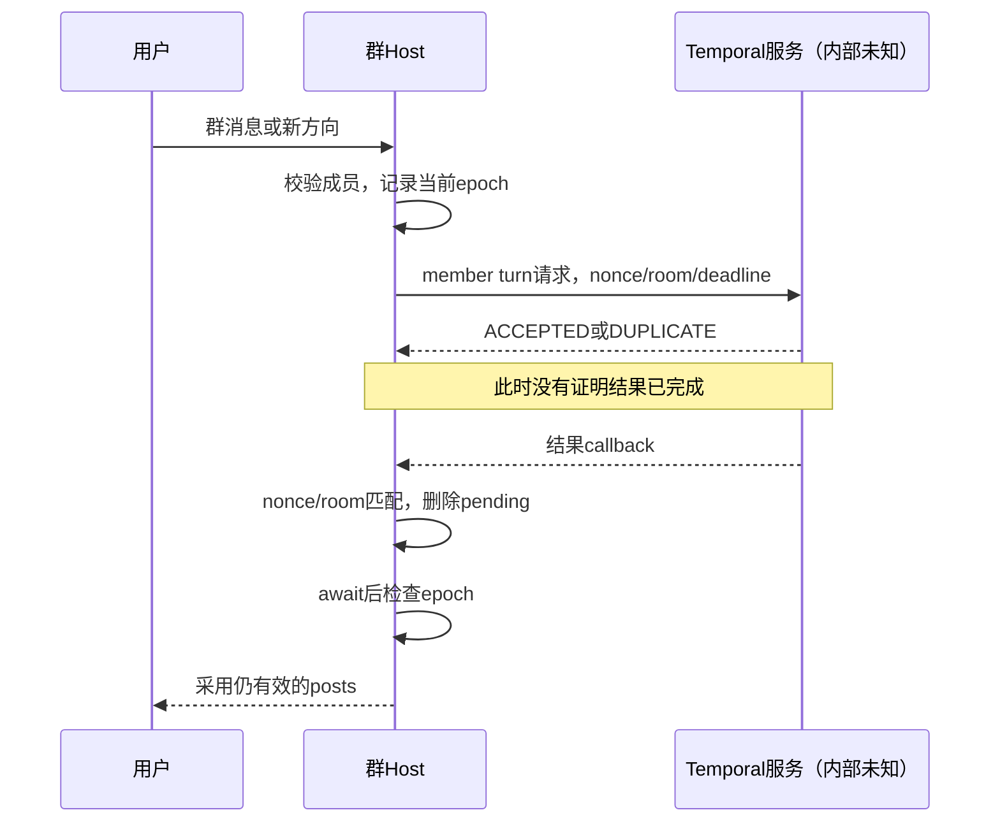

# 最简 Personal Agent：真实产物调研与设计取舍

2026-11-04，第五轮更新。本文是面向产品决策的最新入口，整合前四轮，并新增官方同包评测运行器的提示装配、压缩恢复与失败熔断实测；不把历史实现、当前公开代码和不可见的线上后端拼成一套架构。只做研究，没有开始实现框架。

## 结论先说

我们要解决的核心问题是：**用户表达一次意图之后，系统能否持续、可控地把它变成可验收的结果，并让用户少操心。** 多 Bot、群聊、记忆、定时器都是服务这个结果的机制。

目前证据足以确定最小框架的主要取舍，但不够声称完整还原 Grok 云端。最有价值的发现是：

1. 长期 Bot 是持续的身份、职责与记忆范围；Worker 是一次委派中的执行身份。二者可以共用执行内核，不能共用生命周期假设。用户直达任意 Bot，不需要强制总管。
2. 发出请求、接受请求、开始执行、产生结果、把结果送到用户、验收目标，是不同事实。当前 Host 的 Temporal 接口与回传保护尤其说明这一点。
3. 结束判定与目标进展必须分开。当前共享结束函数会检查工具成功；目标续跑却仍能被失败或仅被请求的工具清零空转计数。本轮已对真实原函数验证。
4. 团队协作最容易丢失的不是“消息”，而是责任、要求版本和等待关系。nonce、room、epoch 能挡部分过期结果，但不是整个任务协议。
5. 记忆至少要区分归属、受众、来源和用途。项目长期决策不该代替当前待办；同伴转述不该变成用户授权；摘要不该变成事实数据库。
6. cron、todo、goal、复盘提示词的存在，都不证明系统会自主发现并完成工作。真正需要验证的是观察、选择下一步、执行、验收、调整之间的闭环。
7. 用户看到的交流可以很简单，内部责任记录必须清楚。简短更新不能代替成果，工具成功也不能代替业务验收。
8. 当前公开 Host 的普通 Box 模型入口已退役。当前服务端执行器没有取得，不能从包内残留共享代码推断线上采用了哪个版本或开关。

## 证据与版本范围

| 样本 | 实际取得内容 | 能支持的结论 | 不能支持的结论 |
|---|---|---|---|
| G078，官方桌面 0.78.1 | 官方 Linux 包、ASAR、JS；本机 Windows 0.78.1.0 只读观察 | 客户端选路、界面和桥接边界 | 云端调度和最终模型提示 |
| HOST，官方公开更新 2b353c7 | 发布方公开 tgz、同源 SHA、完整 Host bundle | Host 可见入口、适配器、共享代码原函数行为 | 用户云电脑一定部署此构建、完整 Temporal 后台 |
| H018，第三方历史归档 | 固定 commit 的实际 bundle 与切片 | 该归档内部的历史 Bot/Worker/提示/续跑链 | 官方来源已证、当前架构仍如此 |
| Muse 官方网页 | 官方网页分发 JS | 网页可见界面与接口边界 | 未获下载资格的客户端和后台实现 |

REA 固定 6.8.0，Node 固定隔离版本 26.13.0。此前已实际分析桌面、历史、Muse 与当前 Host；本轮再分析当前 Host 的 12 个原字节模块。没有重新安装、修改全局环境或配置 MCP。

当前 Host 主文件 SHA-256：`328b715bed51ac13f549319f84af259b80936cd984e161af4c45a0faad0f1c35`。以下 HOST 行号均为该文件 LF 行号，不适用于其他版本。

证据类型：**静态**表示原代码可见；**隔离**表示真实提取函数在替身依赖下执行；**应用**表示真实客户端观察；**设计**是我们自己的取舍；**未知**是证据无法回答。设计建议不是 Grok 产品事实。

## 一、从用户价值倒推最小实体

以下是我们的候选设计，不是对 Grok 数据库的还原。

| 用户期待 | 最小需要保存什么 | 没有它会怎样 |
|---|---|---|
| “这个同事一直在” | Bot 身份、职责版本、记忆范围、可用能力 | 每轮重新解释，角色漂移 |
| “把这件事办好” | 任务目标、负责人、验收条件、约束和要求版本 | 会话结束就丢责任 |
| “你们自己商量” | 消息关联、委派关系、等待对象、结果回传地址 | 用户成为人工传话员 |
| “我改主意了” | 用户变更事件、版本、取消或替代关系 | 旧工作覆盖新要求 |
| “做完告诉我” | 结果、证据、交付状态、目标验收状态 | 内部做完但用户不知道 |
| “以后持续负责” | 目标状态、下一次唤醒原因、停止条件与预算 | 无休止重复或长期遗忘 |

会话只是交流场所，不应承担任务的唯一身份。一个 Bot 可以参与多个会话；同一个任务可以有多轮 run。群是路由与可见性范围，不天然是总管。团队是成员、共享资源与权限范围，不必另建一套执行器。

Bot 与 Worker 的最小区别：

| 维度 | 长期 Bot | 临时 Worker |
|---|---|---|
| 创建动机 | 用户要一个持续承担职责的同事 | 某任务需要一段可分离工作 |
| 身份 | 可被用户直接寻址，稳定职责 | 关联父任务或委派，临时职责 |
| 记忆 | 长期范围可配置 | 默认仅获任务所需上下文，长期写入另行决定 |
| 生命周期 | 归档/删除独立于一个 run | 完成、取消、超时后回收 |
| 责任 | 可成为根任务负责人 | 返回结果不自动解除根负责人责任 |
| 权限 | 用户授予范围 | 不因被委派而扩权 |

**证据边界：** H018 的长期 peer 与 parent/worker 路径确实不同，见 [历史协作](collaboration-historical.md)、[交接故障](phase2-delegation.md)。当前 Host 的 peer 记录与群 Temporal 调度另见 [当前协作](phase3-host-collaboration.md)，不把 H018 内核宣称为线上现状。

## 二、协作必须闭合的责任链

当前 HOST 可见：本地群入口 → 成员校验与调度 → `runTemporalGroupMemberTurn` → `requestGrokBotRoomMemberTurn` → 服务端未知 → `receiveRoomMemberTurnResult` → nonce/room 匹配 → pending 删除与 resolve → epoch 检查 → 群 posts。

来源：HOST LF722149 起 Temporal 适配器、LF758648 起群成员分发、LF760252 起 epoch；第三轮原函数 15 项。普通 peer DM 的本地记录与内存去重，不等于接收方已经执行。



我们应重写成明确的责任协议：发起者保存任务与验收条件，接收者确认接受，返回产物和证据，由负责人判断是否满足要求。持久任务状态与消息投递状态分开；同一请求的重投不能创建新的业务副作用。

| 故障 | 真实证据 | 我们最小需要补什么 |
|---|---|---|
| 回执说接受但没结果 | Temporal ACCEPTED 后继续等待 | 可查询状态、明确等待期限 |
| 超时后结果晚到 | nonce/room/pending 检查 | 结果隔离保留与人工/策略采纳规则 |
| 用户途中改要求 | 群 epoch 前后检查 | 要求版本进入子任务与产物验收 |
| 取消请求失败 | Host 先本地取消，再尽力远端取消 | “请求取消”与“已停止”分开 |
| 进程重启 | 可见 pending Map 非持久 | 未决任务恢复与对账；不能依赖 Map |
| 成员退出 | 当前全链未证明 | 负责人接管、重派或等待用户的明确策略 |
| 两人写同一成果 | 未证明通用冲突合并 | 产物版本与单一提交点，冲突交负责人 |
| 重复消息 | 当前 peer 去重仅内存、容量有限 | 持久业务幂等键，明确有效期 |

上述“补什么”是设计要求，不声称 Grok 服务端缺失。对同一副作用恰好执行一次的承诺，应由实际拥有该副作用的一层提供证据。

## 三、Nudge：活动不是进展

本轮执行当前 HOST 原始 `GoalContinuationActionHandler`（LF595585–595760）、`ToolCountingStateTracker/createToolCountingMiddleware`（LF585170–585234）和 goal 身份/时钟函数（LF490199 起）。不是重写近似实现。

| 路径 | 原代码依据 | 本轮隔离结果 |
|---|---|---|
| 连续无工具 | 续跑前检查 idle ≥ 3，随后加一 | 前 3 次续跑，第 4 次暂停，累计续跑仍为 3 |
| 只请求工具 | model-step 看 descriptors 长度 | 工具尚未执行即清零 |
| 无效请求重复 | 同上，无有效结果判定 | 连续 20 次相同描述仍清零，局部上限不触发 |
| single-step | 看 hasToolCall | 返回含失败信息也清零 |
| 完整 handle | 计数 middleware 记录结果后加一 | 已记录失败工具结果同样清零 |
| 记录结果时抛错 | 加一在 await record 之后 | 计数未增加 |
| 模型异常 | 先增加续跑计数再调用模型 | 异常保留已增加计数 |
| 暂停/身份不符/非法 ID | adaptAction 验证 | 不进入模型处理 |
| 时钟倒退或暂停 | 累计时间与 anchor | 不倒扣，不把无 anchor 等待时间算工作时间 |

**重要限度：** 这里只证明该共享 handler 的局部控制流。没有真实工具、网络、模型或生产 scheduler，不能推出线上无限运行。外层预算与策略是否另有限制未知。

第三轮验证的严格 `resolveStepTurnEnd`（LF587738 起）与这里不矛盾：它要求明确成功结果，并能在并行工具失败时阻止结束；它不负责证明目标进展。它们属于不同层。

我们的最小状态应区分：

| 状态/事件 | 含义 | 下一步 |
|---|---|---|
| 模型停止输出 | 一次模型生成结束 | 检查待执行工具与任务状态 |
| run 结束 | 本次执行结束 | 保存结果，不自动完成目标 |
| 等用户 | 缺决定或授权 | 等用户事件，不定时催模型空转 |
| 等同伴 | 有明确未决委派 | 等结果/超时，不重复委派 |
| 等外部事件 | 尚无符合条件的新信息 | 保留订阅或下次检查时间 |
| 无进展 | 没有增加证据、产物或状态变化 | 有界纠偏、换假设，最终报告阻塞 |
| 任务完成 | 验收条件有对应证据 | 交付并记录验收 |
| 目标完成 | 目标层条件满足 | 终止相关续跑与触发器 |

**设计：** 分开记录活动数、有效进展、重复失败、消耗与等待原因。读取新来源、排除假设、验证失败原因也可能是有效进展，不应只数写文件。重复同一个失败参数不能无限刷新进展时钟。Nudge 应携带缺口及最新事实，允许结束、等待或报告阻塞，不应永远强迫调用工具。

## 四、记忆：谁的事实、谁能看、为什么相信

本轮静态读取 HOST memory-types、memory-jsonl、memory-folders、memory-prompt，并执行 10 项原 helper 测试。

| 原产物概念 | 可见行为 | 对我们的价值 |
|---|---|---|
| user / bot owner | 分别映射 `/me`、`/bot` | 用户共享事实与角色知识分开 |
| always_in_context / library | 类型定义区分常驻与查阅 | 不把所有历史塞进每轮提示 |
| behavior | 区分暂时表达与长期规则 | “今天简短”不应自动变永久偏好 |
| workstream | 强调长期目标、决策及其变更理由 | 保存长期决策，不代替执行待办 |
| source / speaker / created_at | JSONL 记录字段 | 事实可追溯，防转述失真 |
| untrusted_raw / pending_review | folder helper 跳过这两类前缀 | 外部材料不直接晋升为可靠记忆 |
| team / user audience | helper 传递受众元数据 | 共享记忆必须检查实际读写授权 |

来源：LF717318 类型 schema；LF777025–777096 类型定义与默认集合；LF777102–777231 解析与 folder helpers；LF777254 起提示常量。原文保存在私有样本/切片中。

实测确认：未信任前缀在解析前跳过；未知类型、旧 shard 不进入该 JSONL view；按路径、时间、ID 排序；同 ID 记录并不在这个 helper 去重；audience 只是传递，不能视为此处执行了 ACL。路径检查是字面前缀，不证明上游是否规范化，不能据此宣布漏洞。

测试中的 JSONL parser 是供应预验证记录的替身，因此 **没有验证真实 Zod schema、后端读写隔离、生产记忆抽取或遗忘**。

还发现一个不能省略的条件：包中注册 8 种 memory types，但默认启用集合只有 4 种旧 profile/journal 类型。`dreamPrompt` 只是配置文本，已读范围没出现它驱动定时复盘的执行链。不能把所有新类型与自动复盘描述成当前线上默认功能。

我们应该保留三种不同东西：当前任务账本；可修订、有来源的长期事实；用于模型恢复的摘要。摘要可重建，任务账本不能因压缩而消失。共享与私有记忆必须由真实存储访问控制落实，不能只靠提示词。

## 五、提示词与授权：区分指令、事实和转述

第五轮已在官方同包 EVAL 中追到具体 Bot 装配：buildAgentForRun → createSystemPromptGeneratorForRun → renderSections/renderSystemPrompt → system 消息；记忆事实等可另走 UserInfo user 消息。它是评测运行器真实实现，完整生产部署与配置仍未知。历史 H018 的更完整拼装仅作为对照，见 [提示词报告](prompts.md)、[当前提示边界](phase3-host-continuation.md)。

HOST LF774042–774085 包含多种 peer wake 与后台结果提醒：同伴不能自行代表用户批准动作；有的变体允许沿原会话让发起者代问用户；有的变体把后台结果写回 owner notes。**这些变体的定义存在，未追到当前生产选择和注入条件。** 不选择某一版原文冒充线上提示。

设计上，基础行为、角色职责、用户长期偏好、任务要求、证据、工具说明和运行时提醒应分别拥有来源与版本。用户更改要求时更新任务事实；网页内容、同伴报告和工具错误进入数据层，不自动成为更高优先级指令。

权限随任务传递的是有范围的用户授权引用，不是“某 Bot 说用户同意了”。同伴可以代传问题和答案，系统应仍能定位用户原始授权。审批等待属于任务状态，不是模型需要不断追问的信号。

用户界面只需回答三件事：现在做到了哪里、需要我决定什么、结果在哪里。内部可以保存 ID、版本、验收与失败信息。不要强迫用户理解这些字段，也不要用固定冗长状态播报替代自然对话。

## 六、长期自主工作的闭环

第一性原则的闭环是：**目标及约束 → 观察现状 → 找到差距 → 选择可验证行动 → 执行 → 核对结果 → 修改下一步或等待。** 这是一项设计要求，目前没有证据证明 Grok 当前服务端完整实现了这个闭环。

| 机制 | 单独能证明什么 | 不能自动证明什么 |
|---|---|---|
| todo | 模型记录了计划项 | 已创建可执行持久任务 |
| cron / routine | 存在时间触发能力 | 会主动发现应该做的工作 |
| 事件订阅 | 可按事件唤醒 | 能识别业务机会或正确处理所有重复 |
| goal continuation | 可再次进入处理 | 在朝目标取得有效进展 |
| dream / review 提示 | 有复盘指导文本 | 有调度、有新证据、有策略改变 |
| 工具发现 | 能发现或描述能力 | 已授权、已接入且能完成实际动作 |

业务中性例子：“持续保持项目资料准确”。第一次应先确定资料范围、更新判据和来源；识别可订阅事件或合理检查周期；保存持久触发回执；每次比较变化，生成有来源的差异，验证后交付。没变化就等待，有冲突就请负责人决定。不会因为写了 todo 就算已安排。

自媒体例子：“持续提升某主题内容质量”。策略、素材来源、实验指标和发布授权是可替换任务配置。研究、制作、验证可在授权内推进；发布是单独副作用。没有足够数据就不伪造策略提升，复盘要能关联具体实验和结果。内核不内置网站或行业 SOP。

最简版本不必先做通用自动规划器：先让一个负责人能把下一步及其等待原因可靠保存，再增加独立 Worker、持久触发与策略复盘。规划复杂度应来自任务，不来自预设的多层组织结构。

## 七、借鉴、重写、不照搬

| 分类 | 决定 | 理由/证据 |
|---|---|---|
| 借鉴 | Bot 身份与 run 分开，用户可直达 | 历史多实体与当前多路由支持这种分离 |
| 借鉴 | 关联 ID、结果匹配、过时结果保护 | 当前 Temporal nonce/room/epoch 原函数 |
| 借鉴 | 工具成功、显式交付与结束分开 | 当前 turn-ending 原函数 |
| 借鉴 | 记忆 owner、audience、source、常驻/检索区分 | 当前类型与 folder helpers |
| 重写 | 持久责任/委派/验收协议 | 当前 Host 只证明局部桥接，不能代替云端实现 |
| 重写 | 有效进展与重复失败判断 | 当前 goal handler 的 15 项实验 |
| 重写 | 上下文构建与恢复 | 当前完整生产 assembler 未取得；历史仅供结构参考 |
| 重写 | 权限传递与授权溯源 | 提示提醒不是强制执行边界 |
| 不照搬 | 强制总管、Agent 层层包装 | 用户直接指导与最小状态模型不需要它 |
| 不照搬 | 调用工具即进展，模型说完成即验收 | 活动与成果是不同事实 |
| 不照搬 | 把 Map 当持久队列，把 cron 当自主规划 | 本地机制证明范围有限 |
| 不照搬 | 历史/共享提示原文作为我们的默认策略 | 启用未知、许可独立、需按产品需求重写 |

## 八、最小实现顺序与验收门槛

这只是未来实施顺序，本轮没有写框架。

1. **单 Bot 可靠交付。** 保存任务、run、证据和交付状态；真实工具失败不能报成功；重启后能恢复未决任务。
2. **等待、取消与要求修改。** 等用户不空转；取消有可观察状态；旧版本结果不能覆盖新要求。
3. **临时 Worker。** 委派可查询、可超时、可回传；父任务继续承担验收；不能扩权。
4. **多个长期 Bot 与直接私聊/群聊。** 共用执行内核；记忆和受众隔离；成员退出可接管。
5. **持久触发与长期目标。** 存安排回执；测试时区、重复投递、断线补做、重启对账和预算。
6. **策略复盘。** 每次策略变化关联新证据与可检验假设；没有变化就合法等待，不强迫“自主”制造工作。

可交付验收场景：同一请求重复提交；接受后断线；执行后回传丢失；用户改要求；并行成果冲突；等待用户时重启；同伴退出；超时后晚回；工具失败 20 次；成功无新信息重复 20 次；目标达成后触发器仍到达。这是我们以后要实现的测试要求，不是宣称本轮都验证了 Grok。

## 九、研究完成程度与未解锁部分

| 原研究问题 | 已覆盖 | 尚不能回答 |
|---|---|---|
| Bot / Worker / 会话 / 团队 | 历史全链与当前实体/路由边界 | 当前服务端创建、销毁和隔离完整实现 |
| 真正协作 | 历史回传故障；当前群适配器、回传、取消、epoch | 云端执行/持久化/业务重试/崩溃恢复 |
| 提示与人设 | 历史组装；当前官方 EVAL 完整章节构造、默认顺序、generator 与消息角色；恢复 helper 实测 | 线上部署、真实开关与最终模型请求 |
| Nudge 与目标 | 历史测试；当前严格结束与目标原函数；EVAL 电脑 Worker 连续失败 breaker 实测 | 生产 scheduler 如何采用、通用有效进展与全局预算 |
| 长期自主工作 | 调度与规划分离、历史 automation、当前入口退役 | 当前真实策略调整与完整业务闭环 |
| 记忆与权限 | 类型、来源、默认集合、可见 helper 测试 | 服务端 ACL、真实抽取/遗忘/授权执行 |
| Muse | 官方网页实际 REA | 受资格限制的产物与后台 |

我的判断：**针对最简框架的高价值设计问题，本轮已完成证据归纳与可行的关键补测；没有完成 Grok 全产品、全服务器的穷尽逆向。** 第五轮修正：同包的 EVAL 之前未充分检查，实际保留更完整运行器，仍有可继续的离线路径。生产持久服务的事务与部署配置仍需要新的服务端证据或真实远端实验，EVAL 不能替代它们。

本机观察只确认额度已用满、云电脑休眠，没有触发模型、开启额外用量或唤醒云电脑。后续行为验证可以等额度恢复并明确实验范围；得到账号行为也仍不等于取得服务端源码。整个第四轮只做后台文件和隔离 Node 分析，没有操作屏幕。

## 十、证据入口与复现

详细来源和前三轮：

- [当前官方 Host 深挖](当前官方Host后端深挖.md)：来源 SHA、架构与 40 项当前原函数测试。
- [第四轮验证与证据](phase4-validation.md)：本轮 25 项实验、REA、原切片、替身边界。
- [第二轮验证](phase2-validation.md)：前两轮 105 项，含历史样本与桌面，不算当前云端测试。
- [历史协作](collaboration-historical.md)、[当前协作](phase3-host-collaboration.md)、[当前续跑](phase3-host-continuation.md)。
- [提示词](prompts.md)、[长期任务](long-term-work.md)、[Muse](muse-report.md)、[本机只读观察](本机验证状态.md)。

测试统计必须按范围分开：前两轮 105；第三轮当前 Host 40；第四轮当前 Host 25；第五轮 HOST 22 与 EVAL 18，共新增 40。本轮通过不等于真实模型任务成功，真实远端模型实验仍为 0。

私有研究根目录为当前工作区的 `work/research/grok-bot-rea`。本轮原件对应 `targets/host-2b353c7/sand-host/host-main.cjs`；12 片在 `targets/host-2b353c7-phase4`；证据、测试和日志在 `evidence/phase4` 与 `commands/phase4-*`。原始第三方提示不放入公开建议稿，不自动提交 Git。

复现本轮全部原函数测试及字节核验：

```powershell
Set-Location 'C:\Users\asus\Documents\Codex\2026-11-03\github-rea-grok-bot-muse-personal'
python work/research/grok-bot-rea/scripts/verify-phase4.py
```

该命令检查主文件 SHA、12 个模块的原字节一致性，再用隔离 Node 运行 25 项用例并落盘时间、命令、退出码和结果。它不启动 Grok、不访问模型、不读取个人聊天。

## 十一、第五轮新增：三项未知已经推进到哪里

本轮发现此前漏查的官方同包 `sand-eval-runner.cjs`。它包含 `buildAgentForRun`、完整 `createSystemPromptAssembly` 和基础提示构造；已经对实际原模块运行 REA。此前“当前只能看到共享提示接口”的表述需要细化：Host 主文件覆盖不足，但同包 EVAL 可见更完整实现；它仍不是已确认的生产服务端。

**提示装配。** 默认插入顺序为 base/spotlight/voice → profile/用户/团队 → multitask/时区 → memory/会话 → automations/tasks/skills/channels/成员目录/发送规则/MCP → 电脑环境。缺失功能可省略章节，override 与 frozenPrompt 可改变结果。记忆政策留在 system，事实在相应 gate 下进入 UserInfo user；任务章节对 subagent 和 system override 不启用。工具 schema 单独构建，已挂载工具集合又影响提示中对能力的描述。

**压缩恢复。** 同 epoch 固定旧前缀，动态变化通过 instructions_update 宣布；下一 epoch 重读 live。依赖暂未解析保留旧值，明确删除才清空；切换对话对象重新准备个人 notes。原 generator 在压缩代次变化后刷新 profile，并在异常时清除临时代次。已做原函数隔离验证，未执行完整真实压缩回合。

**持久调度。** 服务接口有 workflow、run、过滤与重试资格字段，但后台实现不可见。本地 FileAutomationStore 分开记录配置与运行历史；同 Bot 的变更队列只在进程内串行。名为 CloudSync 的模块实际重试 Bot 删除后的远端 routine 清理：列出→删除→回读确认。测试证实一次 RPC 成功不等于删除收敛，回读已空也可消解一次 RPC 错误；本地 pending Set 没有自行跨实例恢复的代码。

**自主规划与约束。** routine 的真实写入函数拒绝在 routine run 中新建另一个 routine；更新必须确认唤醒来源，只能改自身且不能重新启用。需要 review 而 Host 无法 review 时也拒绝更新。六项原分支已测，不能用这些测试冒充成功调度闭环。任务记录、Worker、routine 与负责人需要分工，定时 Worker 不应默认拥有无限扩展计划的权限。

**纠正失败保护范围。** 第四轮 goal idle 的问题仍成立，但 EVAL 另有电脑操作 Worker 专用 breaker：连续 20 次失败触发，成功清零，审核拒绝/取消事件跳过，触发后锁定。它不自动覆盖所有 Bot，也不等于有效进展判定。框架应分别设计活动计数、失败熔断、目标进展和预算。

新增 40 项测试（HOST 22、EVAL 18）全部通过。原始代码、替身边界、精确 LF/SHA、REA Evidence、复现命令见 [第五轮完整专题](phase5-服务端边界与评测运行器深挖.md)。原材料仅在私有研究目录；没有运行整个评测程序或触发模型。

下一步仍可沿 EVAL 的 turn settle、Worker revival、state adapter 和各 gate 做离线补证；当前服务端数据库/队列/租约/生产配置依然没有取得。这比笼统写“未知”更精确，也不再声称同一包已无可挖内容。
